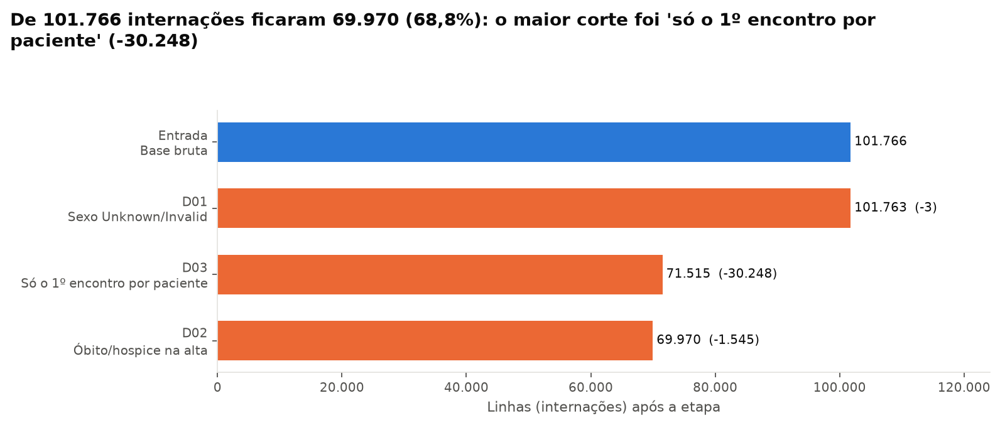
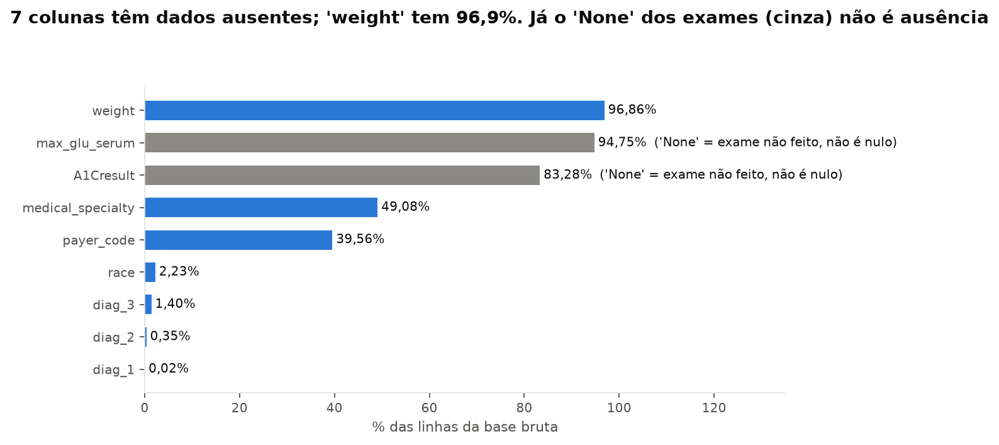
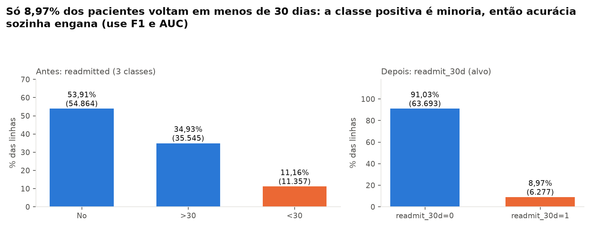
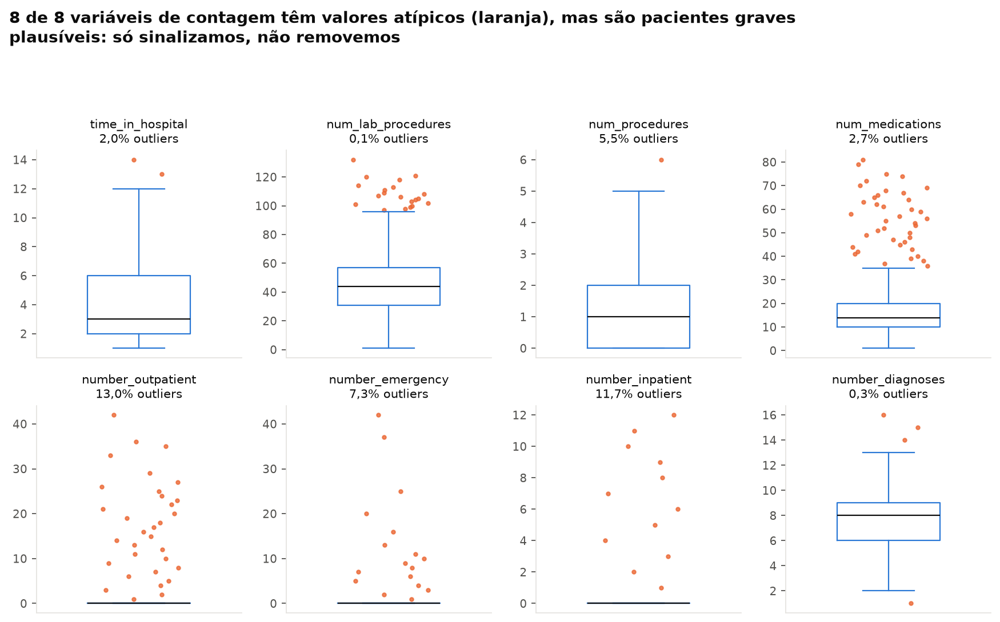
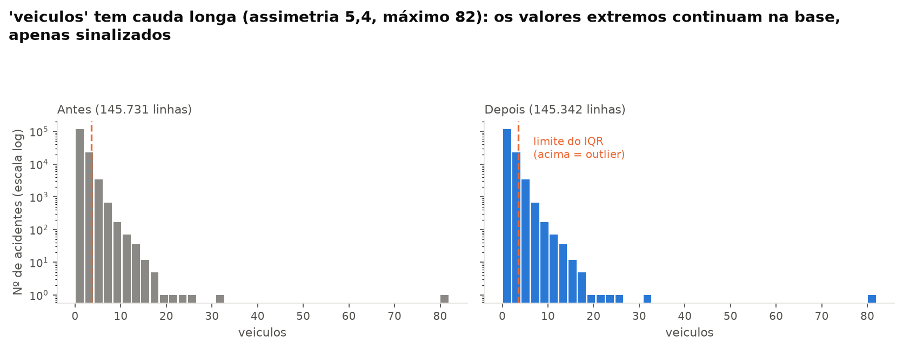
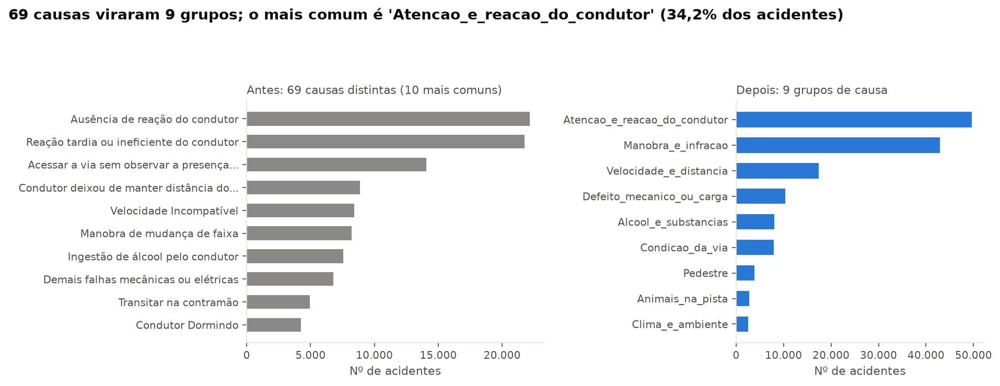
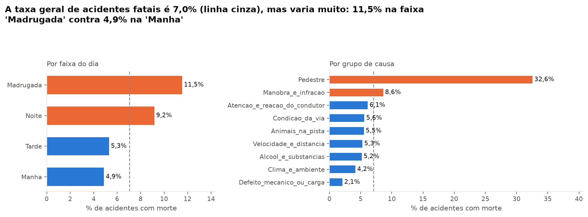

# README — Engenharia de Dados e Pré-processamento

> Este é o README **da parte de Engenharia de Dados e Pré-processamento** (limpeza, integração e atributos), não o README do repositório. Ele é a base da apresentação desta etapa. **É gerado por código** (`python -m src.p1_engenharia_dados.executar_pipeline`) e todos os números vêm de [`tabelas/`](tabelas/). Não edite à mão: rode o pipeline de novo.

## 1. Resumo em 30 segundos

- **De onde vem:** Dados Abertos da **PRF** (Polícia Rodoviária Federal), acidentes em rodovias federais de **2024 e 2025**: **145.731 acidentes** em 30 colunas, mais **391.077 linhas de pessoas/veículos** em outro arquivo. Queremos entender e prever quais acidentes terminam em **morte**.
- **O que estava errado:** dados de pessoas em arquivo separado, idades impossíveis (máximo de 2024 anos), ano de fabricação 0, "não sei" escrito de várias formas, contagens de vítimas que não fecham (7.672 acidentes), traçado da via com 898 combinações e 69 causas.
- **O que fizemos:** juntamos pessoas aos acidentes, anulamos valores impossíveis, unificamos os rótulos, removemos 389 linhas (suicídios presumidos e sinistros pessoais; nenhum duplicado), criamos atributos de hora, calendário, causa, via e envolvidos, sinalizamos outliers e tiramos as colunas que **vazam o alvo**. **Sem escalonar, sem one-hot, sem imputar média:** isso é da Pessoa 3, depois do split.
- **O que ficou:** **145.342 acidentes × 42 colunas** em `data/processed/`, com **7,05%** de acidentes fatais (classe desbalanceada).

## 2. Diagrama do pipeline

Cada caixa mostra o tamanho da base **depois** da etapa.

```mermaid
flowchart LR
    N0["Bruto (ocorrências)<br/>145.731 linhas × 30 colunas"]
    AUD["Auditoria inicial<br/>só mede, não altera"]
    N1["Integração com pessoas (I01)<br/>145.731 linhas × 38 colunas"]
    N2["Padronização de rótulos (D04)<br/>145.731 linhas × 38 colunas"]
    N3["Filtros D01 e D02<br/>145.342 linhas × 38 colunas"]
    N4["Inconsistências (D03, D07)<br/>145.342 linhas × 39 colunas"]
    N5["Atributos (F01-F11)<br/>145.342 linhas × 58 colunas"]
    N6["Outliers (sinalização)<br/>145.342 linhas × 62 colunas"]
    N7["Seleção (base final)<br/>145.342 linhas × 42 colunas"]
    N0 --> AUD --> N1
    N1 --> N2
    N2 --> N3
    N3 --> N4
    N4 --> N5
    N5 --> N6
    N6 --> N7
```



## 3. Funil de linhas

Saímos de **145.731** e ficamos com **145.342** (99,73% do total). Esta base perde pouca coisa: ela já vem organizada pela PRF. O maior corte foi **suicídio presumido e sinistro pessoal** (D02).



| ID | O que fez | Linhas antes | Removidas | % do bruto | Linhas depois |
|---|---|---|---|---|---|
| Entrada | Base bruta | 145.731 | 0 | 0,000% | 145.731 |
| D01 | Acidentes duplicados | 145.731 | 0 | 0,000% | 145.731 |
| D02 | Suicídio presumido e sinistro pessoal | 145.731 | 389 | 0,267% | 145.342 |

- **D01**: duplicidade checada **depois** de juntar as pessoas. 1 registro(s) igual(is) no arquivo de ocorrências; após juntar as pessoas, 0 continuam idênticos (os demais são acidentes distintos).
- **D02**: suicídio presumido e sinistro pessoal não são acidentes de trânsito. Nenhuma ação de segurança viária os evitaria e eles inflariam a taxa de fatais. Foram 389 acidentes, 195 deles fatais.
- A integração com o arquivo de pessoas **não perde acidentes**: 0 acidentes ficaram sem pessoas.

## 4. Mapa de ausentes e valores impossíveis



| Coluna | Arquivo | ID | Linhas afetadas | % antes | O que fizemos | Situação final |
|---|---|---|---|---|---|---|
| sexo | pessoas | D04 | 58.582 | 14,98% | nulo/Ignorado/Não Informado -> 'Nao_informado' | resumido por acidente (F11) |
| estado_fisico | pessoas | D04 | 57.615 | 14,73% | nulo -> 'Nao_informado'; não é usada (consequência) | não usada |
| ano_fabricacao_veiculo (impossível) | pessoas | D06 | 35.155 | 8,99% | vira nulo (não é substituído) | 5.545 acidentes sem idade média de veículos |
| tipo_envolvido | pessoas | D04 | 34.351 | 8,78% | nulo -> 'Nao_informado' | resumido por acidente (F11) |
| idade (impossível) | pessoas | D05 | 20.841 | 5,33% | vira nulo (não é substituída) | 7.009 acidentes sem idade média de condutores |
| tipo_veiculo | pessoas | D04 | 12.939 | 3,31% | nulo -> 'Nao_informado'; veículo não entra nos tipos F11 | resumido por acidente (F11) |
| condicao_metereologica | ocorrencias | D04 | 1.933 | 1,33% | 'Ignorado' -> 'Nao_informado' | categoria 'Nao_informado' |
| condicao_metereologica | pessoas | D04 | 4.587 | 1,17% | 'Ignorado' -> 'Nao_informado' | categoria 'Nao_informado' |
| sentido_via | pessoas | D04 | 1.034 | 0,26% | 'Não Informado' -> 'Nao_informado' | categoria 'Nao_informado' |
| sentido_via | ocorrencias | D04 | 356 | 0,24% | 'Não Informado' -> 'Nao_informado' | categoria 'Nao_informado' |
| classificacao_acidente | ocorrencias | D04 | 2 | 0,00% | 'NA' -> 'Nao_informado' | coluna sai da modelagem (consequência) |
| classificacao_acidente | pessoas | D04 | 10 | 0,00% | 'NA' -> 'Nao_informado' | coluna sai da modelagem (consequência) |
| latitude/longitude (fora do Brasil) | ocorrencias | D07 | 0 | 0,00% | vira nulo só se impossível | 0 nulos |

**Ponto didático:** aqui quase não há nulo de verdade (só 2 textos `NA`). O problema é diferente: **rótulos "não sei"** (`Ignorado`, `Não Informado`, `NA`) e **valores impossíveis** (idade 2024, ano de fabricação 0). Nulo declarado é fácil de ver; valor impossível passa despercebido e estraga a média. Por isso a auditoria olha os valores, não só os nulos.

## 5. O que estava errado → o que fizemos → por quê

Esta é a tabela mais importante. Cada linha é uma decisão registrada no código com o mesmo ID.

| ID | O que estava errado | Evidência (número) | O que fizemos | Por quê | Impacto |
|---|---|---|---|---|---|
| I01 | Idade, sexo e tipo de veículo estão em outro arquivo (um por pessoa) | 391.077 linhas de pessoas para 145.731 acidentes; 0 acidentes sem pessoas | Resumir as pessoas por acidente (F11) e juntar pelo `id` (join à esquerda) | Idade do condutor, moto, caminhão e pedestre ajudam a explicar o risco e só existem nesse arquivo | +8 colunas; nenhum acidente perdido |
| I02 | Os dados não dizem se o dia era feriado | 5.334 acidentes (3,67%) caíram em feriado nacional | Calcular feriados nacionais (fixos + Páscoa) e criar `eh_feriado` | Feriados concentram viagens longas e mudam o perfil do tráfego | +1 coluna |
| I03 | 27 UFs e quase 2 mil municípios para descrever o local | 27 UFs e 1.943 municípios | Mapear UF -> região do Brasil (IBGE) e criar `regiao` | Reduz a cardinalidade mantendo o sentido geográfico | +1 coluna |
| D01 | Acidentes que podem ter sido lançados duas vezes | 1 registro(s) igual(is) ao anterior em todos os campos do arquivo de ocorrências (exceto o `id`); depois de juntar as pessoas, 0 continuam idênticos | Checar a duplicidade **depois** de juntar as pessoas e remover só os idênticos também nelas | Dois registros iguais só no cabeçalho podem ser acidentes distintos no mesmo minuto; remover seria apagar um acidente real | -0 linha(s) |
| D02 | Suicídios presumidos e sinistros pessoais não são acidentes de trânsito | 389 acidentes: causa 'Suicídio (presumido)' (377) ou tipo 'Sinistro pessoal de trânsito' (20) | Remover | Nenhuma ação de segurança viária (fiscalização, sinalização, obra) evitaria esses eventos; eles inflariam a taxa de fatais | -389 linhas (195 fatais) |
| D03 | As contagens de vítimas não fecham | 7.672 acidentes (5,28%) em que mortos + feridos + ilesos + ignorados != pessoas | Sinalizar em `contagens_inconsistentes` (só no interim); não corrigir | Não sabemos qual campo está errado; o alvo usa só `mortos` | 0 linhas removidas |
| D04 | A PRF escreve "não sei" de várias formas | 'Ignorado' em 1.933 acidentes (clima), 'Não Informado' em 356 (sentido da via), 'NA' em 2 (classificação); sexo sem informação em 14,98% das linhas de pessoas | Unificar em `Nao_informado` | Palavras diferentes para a mesma coisa viram categorias falsas para o modelo | 2.291 células ajustadas |
| D05 | Idades impossíveis | Idade máxima de 2024 anos; 420 idades fora de 0 a 110; 20.421 condutores (8,34%) com menos de 10 anos (a PRF usa 0 como 'não informado') | Idade impossível vira nulo (não é substituída por média) | Não dá para saber a idade real; inventar uma distorceria a média de idade dos condutores | 7.009 acidentes (4,82%) ficam sem idade média |
| D06 | Ano de fabricação impossível | 35.155 linhas de pessoas (8,99%) com ano 0, 1900 ou futuro, sendo 35.106 com 0 | Vira nulo; a idade do veículo só usa anos válidos | O valor 0 viraria veículos de 2.025 anos | 5.545 acidentes (3,82%) ficam sem idade média de veículos |
| D07 | Latitude positiva parece erro, mas não é | 593 acidentes com latitude >= 0, todos em UFs ao norte do Equador (válidos: 593); 0 coordenadas fora do Brasil | Conferir contra a caixa do Brasil e a UF; anular só as impossíveis | Latitude positiva é correta em AP e RR; removê-las seria um erro | 0 coordenadas anuladas |
| O01 | Valores extremos (cauda longa) | 4 de 4 variáveis têm outliers pelo IQR (de 0,63% a 7,19% das linhas); um acidente chega a 82 veículos | Só sinalizar (colunas `*_outlier`); não remover nem limitar | Acidentes com muitos veículos existem (engavetamentos) e estão entre os mais graves; limitar valores exige estimar limites só no treino (Pessoa 3) | +4 colunas de sinalização; valores intactos |
| S01 | Colunas que vazam o alvo, são administrativas, redundantes ou sem informação | 8 colunas de consequência do acidente; 0 quase constantes; 0 pares com \|r\| > 0,9 | Remover identificador, consequências, administrativas, substituídas, quase constantes e redundantes | As consequências (mortos, feridos, classificação) definem o alvo: usá-las seria vazamento | 63 colunas no interim -> 42 na base de modelagem |

## 6. Antes × depois

### 6.1 O alvo (balanceamento de classes)



A PRF classifica o acidente em 3 classes (`Sem Vítimas`, `Com Vítimas Feridas`, `Com Vítimas Fatais`). Criamos `acidente_fatal` (1 = ao menos uma morte). No bruto, 7,16% dos acidentes tinham morte; depois dos filtros, **10.240** acidentes (**7,05%**). É minoria: na modelagem, prefira F1, AUC e *class weights* à acurácia.

### 6.2 Outliers (só sinalizados)





| Variável | Q1 | Q3 | Limite superior | Outliers | % outliers | Máximo | Assimetria |
|---|---|---|---|---|---|---|---|
| veiculos | 1,00 | 2,00 | 3,50 | 10.446 | 7,19% | 82,00 | 5,36 |
| km | 75,20 | 406,80 | 904,20 | 1.568 | 1,08% | 1470,00 | 1,01 |
| idade_media_condutores | 32,00 | 48,00 | 72,00 | 920 | 0,63% | 94,00 | 0,43 |
| idade_media_veiculos | 6,00 | 15,00 | 28,50 | 2.706 | 1,86% | 75,00 | 1,10 |

4 de 4 variáveis têm outliers pela regra do IQR (de 0,63% a 7,19% das linhas). São acidentes e veículos reais (um acidente chega a 82 veículos), então **não removemos nem limitamos**: criamos colunas `*_outlier` (0/1) e deixamos os valores intactos.

### 6.3 Causas (alta cardinalidade)



`causa_acidente` tinha **69** causas distintas; viraram **9** grupos (atenção do condutor, velocidade, álcool, manobra, via...). O traçado da via tinha **898** combinações (ex.: `Reta;Declive`) e virou **8** colunas 0/1.

### 6.4 Padrões que já aparecem (descritivo; a Pessoa 2 testa)



Só uma prévia, **sem teste estatístico**: a taxa geral de acidentes fatais é 7,05%. Na madrugada é 11,53%, contra 4,87% de manhã. Quando há pedestre envolvido, é 28,04%; com motocicleta, 6,16% (sem moto, 7,74%). Nas causas de álcool, 5,18%. Estes números justificam criar os atributos de faixa horária, causa e envolvidos.

## 7. Atributos criados (F01–F11)

Todos usam só informação sobre **quem e como** (hora, local, via, envolvidos) e **nunca** a consequência do acidente. O resumo numérico de cada coluna está em `tabelas/atributos_criados.csv`.

| ID | Colunas criadas | Como foi criada | Intuição de negócio |
|---|---|---|---|
| F01 | `acidente_fatal` | 1 se mortos > 0, senão 0 | É o que queremos prever: o acidente teve morte? |
| F02 | `hora`, `faixa_horaria` | Hora extraída do horário; faixa Madrugada/Manha/Tarde/Noite | O risco muda ao longo do dia e a faixa deixa o padrão visível para o gestor. |
| F03 | `mes`, `ano`, `fim_de_semana` | Extraídos da data (fim de semana = sábado ou domingo) | Sazonalidade e rotina de viagem (fim de semana) mudam o tipo de acidente. |
| F04 | `eh_feriado` | Data comparada ao calendário de feriados nacionais (I02) | Feriados concentram viagens longas e mais risco. |
| F05 | `regiao` | UF mapeada para região do Brasil (I03) | Compara regiões sem as 27 UFs; mantém o sentido geográfico. |
| F06 | `grupo_causa` | As 69 causas agrupadas em poucos grupos (atenção, velocidade, álcool, manobra, via...) | Um gestor age sobre grupos de causa, não sobre 69 rótulos. |
| F07 | `via_reta`, `via_curva`, `via_aclive`, `via_declive`, `via_intersecao`, `via_rotatoria_retorno`, `via_obras_desvio`, `via_ponte_viaduto_tunel` | Traçado composto ('Reta;Declive') separado em colunas 0/1 | Curva, aclive e interseção podem ter risco diferente; juntos viravam centenas de combinações. |
| F08 | `area_urbana` | 1 quando uso_solo = 'Sim' | Trecho urbano tem perfil de acidente diferente do rural. |
| F09 | `br` | Código numérico vira categoria ('BR-116') | BR é um nome de rodovia, não uma quantidade. |
| F10 | `trecho` | Rodovia + faixa de 10 km (ex.: BR-116_km230) | Permite achar trechos críticos (só no interim, por ter muitos níveis). |
| F11 | `envolve_moto`, `envolve_caminhao`, `envolve_onibus`, `envolve_bicicleta`, `envolve_pedestre`, `idade_media_condutores`, `pct_condutores_homens`, `idade_media_veiculos` | Arquivo de pessoas resumido por acidente (I01) | Quem e o quê se envolveu: moto, caminhão, pedestre, idade do condutor e do veículo. |

Também criamos as colunas `*_outlier` (subseção "Outliers", na seção 6) e `contagens_inconsistentes` (só no interim).

## 8. Cuidados

### Vazamento de dados

- **8 colunas de consequência saem da modelagem** (`mortos`, `feridos_leves`, `feridos_graves`, `ilesos`, `ignorados`, `feridos`, `pessoas` e `classificacao_acidente`). Elas definem o alvo ou só existem depois do acidente. Ficam no interim para rastreio.
- **Nada de escalonar, codificar ou imputar aqui.** Essas contas aprendem com os dados e precisam ser feitas só no treino, dentro de um `Pipeline` do sklearn (Pessoa 3).
- Os limites do IQR e a detecção de colunas quase constantes usam frequência na base inteira, mas nunca o alvo; a Pessoa 3 pode recalcular no treino se quiser rigor máximo.
- **Causa e tipo do acidente só são definidos pela PRF depois do atendimento.** Servem para *explicar* o risco e orientar decisões (onde reforçar o quê), mas um modelo que os use não funcionaria como alerta antes do acidente.

### Nulos que sobram (de propósito)

O plano da equipe fala em base "sem nulos". Na modelagem sobram nulos em **3 colunas** (idade_media_condutores, pct_condutores_homens, idade_media_veiculos): `idade_media_condutores` em 4,82%, `pct_condutores_homens` em 3,47% e `idade_media_veiculos` em 3,82% dos acidentes (sem condutor de idade válida, sexo ou ano de fabricação válido). Preenchê-los com média ou mediana aprende com os dados e, antes do split, vaza informação do teste. **A Pessoa 3 imputa dentro do `Pipeline`** (por exemplo, `SimpleImputer(add_indicator=True)`).

### Atributos sensíveis

2 colunas da base de modelagem vêm de idade e sexo dos condutores (`idade_media_condutores`, `pct_condutores_homens`) e estão marcadas no dicionário. Use-as para **analisar equidade**, não para discriminar.

### Limitações dos dados

- Só entram acidentes **registrados pela PRF em rodovias federais**; ruas urbanas e rodovias estaduais ficam de fora (viés de registro).
- Anos de 2024 e 2025. O ano de 2026 existe, mas é parcial e a PRF atualiza o arquivo todo mês; ficou de fora para a análise ser reprodutível.
- Classe positiva rara (7,05%). Os resultados mostram **associação**, não causa.

### O que verificamos e **não** era problema

| Suspeita | O que encontramos |
|---|---|
| Latitude positiva é erro | Das 593 latitudes positivas, 593 estão em UFs ao norte do Equador (AP e RR): **são válidas**. Coordenadas anuladas: 0 |
| Acidentes sem pessoas ou pessoas sem acidente | 0 e 0: o join casa 100% |
| `id` repetido | Não há: cada `id` aparece uma vez |
| Rótulos iguais com acento ou caixa diferente (`Céu Claro` x `CEU CLARO`) | 0 casos |

## 9. O que entregamos para o resto do grupo

| Arquivo | Para quê |
|---|---|
| `data/processed/acidentes_prf_modelagem.csv` e `.parquet` | Base final: **145.342 linhas × 42 colunas**, alvo `acidente_fatal` na última coluna |
| `data/processed/dicionario_de_dados.csv` | O que cada coluna significa, tipo (10 numéricas, 11 categóricas, 20 binárias, 1 alvo), origem e se é sensível |
| `data/interim/acidentes_prf_limpo.csv` | Versão legível, com `id`, consequências e `trecho` (63 colunas). Gerada pelo pipeline (não versionada: é grande) |
| `docs/tabelas/*.csv` | Evidências de cada decisão (auditoria antes/depois) |
| `docs/figuras/*.png` | Gráficos para o artigo e os slides |

Carregar em 2 linhas:

```python
import pandas as pd
df = pd.read_csv("data/processed/acidentes_prf_modelagem.csv")  # ou pd.read_parquet(...)
X, y = df.drop(columns="acidente_fatal"), df["acidente_fatal"]
```

Para a Pessoa 3: as colunas de texto precisam de *one-hot*; `km`, `veiculos`, `hora` e as idades são numéricas; as colunas `*_outlier` são opcionais; `ano` serve para **validação temporal** (treinar em 2024, testar em 2025) e não como atributo; o *split* treino/teste é de vocês (não geramos).

## 10. Roteiro de fala (3 minutos) e perguntas da banca

### Roteiro

| Tempo | O que dizer |
|---|---|
| 0:00–0:20 | **Origem e justificativa da base:** Dados Abertos da PRF, 145.731 acidentes em rodovias federais (2024–2025), mais um arquivo com 391.077 pessoas/veículos. Escolhida por ser recente, brasileira, ter dois arquivos para integrar e um problema com decisão clara: o que leva a um acidente **fatal**. |
| 0:20–0:50 | Problemas: pessoas em outro arquivo, idade impossível (até 2024 anos), ano de fabricação 0, "não sei" escrito de várias formas e 7.672 acidentes com contagem de vítimas que não fecha. |
| 0:50–1:30 | **Funil:** 145.731 → 145.342. A base perde pouco: 0 duplicados e 389 suicídios/sinistros pessoais. Mostrar o que **não** era problema (latitude positiva em AP/RR é válida). |
| 1:30–2:00 | **Integração e inconsistências:** idade, sexo e veículo vêm do arquivo de pessoas; valores impossíveis viram nulo, sem inventar valor. |
| 2:00–2:30 | **Atributos novos:** hora e faixa do dia, feriado, região, grupo de causa, traçado da via e envolvidos (moto, caminhão, pedestre). Prévia: 11,5% de fatais na madrugada contra 4,9% de manhã. |
| 2:30–3:00 | **Cuidados:** 8 colunas de consequência fora da modelagem (vazamento), classe positiva só 7,0%. Entrega: base de 145.342 × 42 + dicionário. |

### 10 perguntas prováveis (resposta curta)

1. **Por que juntou o arquivo de pessoas?** Idade do condutor, tipo de veículo e pedestre só existem lá, e ajudam a explicar o risco. Resumimos por acidente e juntamos pelo `id`; nenhum dos 145.731 acidentes foi perdido.
2. **Por que removeu suicídios e sinistros pessoais?** Não são acidentes de trânsito: nenhuma fiscalização, sinalização ou obra os evitaria, e eles inflariam a taxa de fatais. Foram 389 acidentes.
3. **Por que não imputou a idade que faltava?** Não dá para saber a idade real, e imputar média aprende com os dados (vaza informação do teste se feito antes do split). Deixamos o nulo e a Pessoa 3 imputa dentro do `Pipeline`.
4. **Por que `mortos` virou alvo e as outras colunas de vítimas saíram?** `mortos` define o alvo; feridos, ilesos e a classificação são consequência do mesmo evento. Usá-los como atributo seria vazamento: o modelo "colaria" a resposta.
5. **Por que escolheram essa base e só 2024 e 2025?** Ela atende às regras do projeto (mais de cinco mil linhas, variáveis numéricas e categóricas, alvo claro, exige preparação, não é base de lista nem *Hotel Booking*) e é recente, como o planejamento pedia. 2026 é um ano parcial e a PRF atualiza o arquivo todo mês; ficar com anos completos torna a análise reprodutível.
6. **Os outliers não atrapalham?** São acidentes reais (um chega a 82 veículos) e estão entre os mais graves. Sinalizamos com `*_outlier` e a Pessoa 3 decide, estimando limites só no treino.
7. **Por que não escalonou nem fez one-hot?** São transformações que aprendem dos dados (média, categorias) e dependem do split. Ficam no `Pipeline` da Pessoa 3.
8. **Como garantiu que não há vazamento?** Consequências fora da base de modelagem, atributos só de hora, local, via e envolvidos, e nenhuma estatística do teste. Reconhecemos que causa e tipo só são conhecidos após o atendimento: o modelo explica risco, não funciona como alerta prévio.
9. **Usar idade e sexo é ético?** Estão marcados como sensíveis (2 colunas, resumidas por acidente). Servem para auditar equidade, não para discriminar.
10. **Os dados são representativos?** Só acidentes registrados pela PRF em rodovias federais. Rodovias estaduais e vias urbanas ficam de fora, então os resultados valem para esse recorte.

## 11. Como reproduzir

```bash
python -m venv .venv
.venv\Scripts\activate            # Linux/Mac: source .venv/bin/activate
pip install -r requirements.txt

python -m src.p1_engenharia_dados.baixar_base          # baixa os 4 arquivos da PRF para data/raw/
python -m src.p1_engenharia_dados.executar_pipeline    # refaz TUDO (dados, tabelas, figuras, textos)
pytest                                                 # confere as regras
python -m pydoc src.p1_engenharia_dados.limpeza        # documentação das funções
```

O pipeline é determinístico: rodar duas vezes gera arquivos idênticos.
