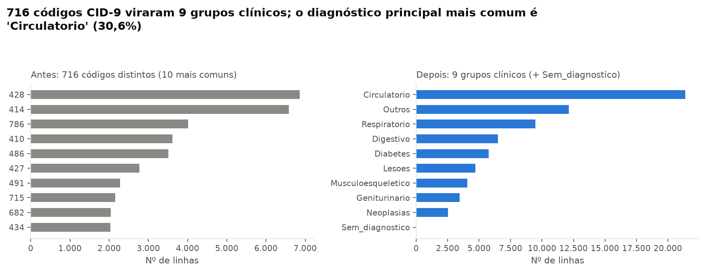
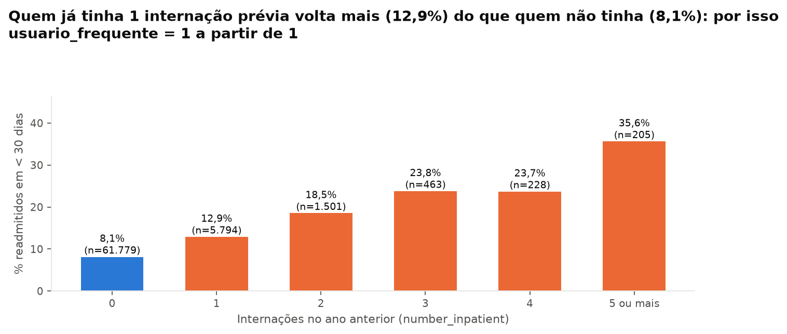

# Tratamento de dados — Pessoa 1 (Engenharia de Dados e Pré-processamento)

> **Este arquivo é gerado por código** (`python -m src.p1_engenharia_dados.executar_pipeline`) e todos os números vêm de [`tabelas/`](tabelas/). Não edite à mão: rode o pipeline de novo.

## 1. Resumo em 30 segundos

- **De onde vem:** base *Diabetes 130-US Hospitals* (UCI, 130 hospitais dos EUA, 1999–2008): **101.766 internações**, **50 colunas**, **71.518 pacientes**. Queremos prever se o paciente volta ao hospital em **menos de 30 dias**.
- **O que estava errado:** `?` no lugar de dado (192.849 ocorrências em 7 colunas), coluna `weight` com 96,86% de ausentes, o mesmo paciente repetido (30.248 encontros a mais), pacientes que morreram ou foram para hospice, códigos numéricos sem nome e a armadilha do `None`.
- **O que fizemos:** juntamos os nomes dos códigos, removemos o que não podia entrar (3 + 30.248 + 1.545 linhas), tratamos os ausentes coluna por coluna, criamos atributos novos, sinalizamos outliers e tiramos colunas sem utilidade. **Sem escalonar, sem one-hot, sem imputar média:** isso é da Pessoa 3, depois do split.
- **O que ficou:** **69.970 linhas × 54 colunas** em `data/processed/`, com **8,97%** de readmissões em < 30 dias (classe desbalanceada).

## 2. Diagrama do pipeline

Cada caixa mostra o tamanho da base **depois** da etapa.

```mermaid
flowchart LR
    N0["Bruto<br/>101.766 linhas × 50 colunas"]
    AUD["Auditoria inicial<br/>só mede, não altera"]
    N1["Integração IDS_mapping<br/>101.766 linhas × 53 colunas"]
    N2["Padronização (D04)<br/>101.766 linhas × 53 colunas"]
    N3["Filtros D01, D03, D02<br/>69.970 linhas × 53 colunas"]
    N4["Ausentes (D05-D09)<br/>69.970 linhas × 54 colunas"]
    N5["Atributos (F01-F11)<br/>69.970 linhas × 69 colunas"]
    N6["Outliers (sinalização)<br/>69.970 linhas × 77 colunas"]
    N7["Seleção (base final)<br/>69.970 linhas × 54 colunas"]
    N0 --> AUD --> N1
    N1 --> N2
    N2 --> N3
    N3 --> N4
    N4 --> N5
    N5 --> N6
    N6 --> N7
```



## 3. Funil de linhas

Saímos de **101.766** e ficamos com **69.970** (68,76% do total). O maior corte foi **só o 1º encontro por paciente** (D03).


| ID | O que fez | Linhas antes | Removidas | % do bruto | Linhas depois |
|---|---|---|---|---|---|
| Entrada | Base bruta | 101.766 | 0 | 0,000% | 101.766 |
| D01 | Sexo Unknown/Invalid | 101.766 | 3 | 0,003% | 101.763 |
| D03 | Só o 1º encontro por paciente | 101.763 | 30.248 | 29,723% | 71.515 |
| D02 | Óbito/hospice na alta | 71.515 | 1.545 | 1,518% | 69.970 |

- **D01** — sexo `Unknown/Invalid`: não dá para recuperar o valor correto.
- **D03** — o mesmo paciente aparece várias vezes; o modelo não pode ver o mesmo paciente no treino e no teste.
- **D02** — óbito/hospice na alta (códigos 11, 13, 14, 19, 20, 21): quem faleceu não pode ser readmitido. No bruto havia 2.423 encontros assim; depois de ficar com 1 encontro por paciente, sobraram 1.545 para remover.

## 4. Mapa de ausentes


| Coluna | ID | Nulos (`?`) antes | % antes | Textos `None` | Decisão | Nulos depois |
|---|---|---|---|---|---|---|
| weight | D05 | 98.569 | 96,86% | 0 | coluna removida | removida |
| medical_specialty | D06 | 49.949 | 49,08% | 0 | nulo -> 'Desconhecido' + flag medical_specialty_ausente | 0 |
| payer_code | D06 | 40.256 | 39,56% | 0 | nulo -> 'Desconhecido' + flag payer_code_ausente | 0 |
| race | D07 | 2.273 | 2,23% | 0 | nulo -> 'Desconhecido' | 0 |
| diag_3 | D08 | 1.423 | 1,40% | 0 | nulo -> 'Sem_diagnostico' | 0 |
| diag_2 | D08 | 358 | 0,35% | 0 | nulo -> 'Sem_diagnostico' | 0 |
| diag_1 | D08 | 21 | 0,02% | 0 | nulo -> 'Sem_diagnostico' | 0 |
| max_glu_serum | D09 | 0 | 0,00% | 96.420 | 'None' -> 'Nao_medido' (não era nulo) | 0 |
| A1Cresult | D09 | 0 | 0,00% | 84.748 | 'None' -> 'Nao_medido' (não era nulo) | 0 |

**Ponto didático (D09):** o `pandas` lê o texto `None` como nulo por padrão. Em `max_glu_serum` (94,75%) e `A1Cresult` (83,28%) `None` quer dizer **"exame não foi feito"**, que é informação, não ausência. Por isso lemos o arquivo com `keep_default_na=False` e só `?` vira nulo. Depois da limpeza sobraram **0** nulos.

## 5. O que estava errado → o que fizemos → por quê

Esta é a tabela mais importante. Cada linha é uma decisão registrada no código com o mesmo ID.

| ID | O que estava errado | Evidência (número) | O que fizemos | Por quê | Impacto |
|---|---|---|---|---|---|
| I01 | Códigos numéricos sem significado (tipo de admissão, destino de alta, origem) | 3 tabelas dentro do IDS_mapping; 11 códigos significam 'sem informação' | Join com o IDS_mapping criando tipo_admissao, destino_alta, origem_admissao; NULL/Not Available/Not Mapped viram 'Nao_informado' | Nomes legíveis ajudam EDA, SHAP e a explicação ao hospital | +3 colunas legíveis; 15.256 linhas usam algum código 'sem informação' |
| D01 | Sexo 'Unknown/Invalid' | 3 registros | Remover os registros | Pouquíssimos casos e sem como recuperar o valor correto | -3 linhas |
| D02 | Pacientes que faleceram ou foram para hospice na alta | 1.545 encontros-índice nos códigos 11, 13, 14, 19, 20, 21 | Remover | Não podem ser readmitidos: o alvo seria 0 por motivo alheio ao atendimento e a taxa de readmissão ficaria subestimada | -1.545 linhas |
| D03 | Mesmo paciente com vários encontros | 30.248 encontros além do primeiro; 16.773 pacientes com mais de um encontro | Manter só o primeiro encontro (menor encounter_id) de cada paciente | Linhas do mesmo paciente não são independentes; no treino e no teste ao mesmo tempo o modelo 'decora' o paciente (vazamento) | -30.248 linhas; 1 linha por paciente |
| D04 | Mesma categoria escrita de formas diferentes | 'NO' em 54.864 linhas de readmitted (o resto da base usa 'No'); 24 descrições do mapeamento com espaço/ponto sobrando | Tirar espaços, padronizar a caixa e unificar NULL/Not Available/Not Mapped em 'Nao_informado' | Grafias diferentes viram categorias falsas para o modelo | 54.864 células ajustadas nos dados |
| D05 | Coluna weight quase toda ausente | 96,86% de nulos | Remover a coluna | Imputar o peso de quase todo mundo seria inventar dado | -1 coluna |
| D06 | payer_code e medical_specialty com muitos ausentes | 39,56% e 49,08% de nulos | Nulo -> 'Desconhecido' e criar flag *_ausente (0/1) | A ausência pode ser informativa (ex.: paciente sem convênio) e não perdemos linhas | +2 colunas de flag; 0 nulos nessas colunas |
| D07 | race com '?' | 2,23% de nulos (2.273 linhas) | '?' -> 'Desconhecido' | Evita perder linhas; é atributo sensível e não deve ser usado para discriminar | 0 nulos em race |
| D08 | diag_1, diag_2 e diag_3 vazios | 0,02%, 0,35% e 1,40% de nulos | Nulo -> 'Sem_diagnostico' | Não ter 2º ou 3º diagnóstico é um fato clínico, não um erro | 0 nulos nos diagnósticos |
| D09 | 'None' em max_glu_serum e A1Cresult parece nulo, mas não é | 'None' em 94,75% (glicose) e 83,28% (HbA1c) das linhas brutas; o pandas lê 'None' como nulo se não for avisado | Ler com keep_default_na=False e renomear 'None' -> 'Nao_medido' | Significa 'exame não feito', que é informação sobre o cuidado ao paciente | Nenhum dado perdido; vira a categoria 'Nao_medido' e as flags F08 |
| O01 | Valores extremos (cauda longa) nas variáveis de contagem | 8 de 8 variáveis têm outliers pelo IQR (de 0,14% a 13,03% das linhas) | Só sinalizar (colunas *_outlier); não remover nem limitar | São clinicamente plausíveis (pacientes graves); limitar valores exige estimar limites só no treino (Pessoa 3) | +8 colunas de sinalização; valores intactos |
| S01 | Colunas sem informação ou redundantes | 11 colunas com um único valor em >= 99,9% das linhas; 0 pares com \|r\| > 0,9 | Remover identificadores, colunas substituídas, quase constantes e redundantes | Menos ruído, nenhum vazamento (e o readmitted original sai da base de modelagem) | 77 colunas no interim -> 54 na base de modelagem |

## 6. Antes × depois

### 6.1 O alvo (balanceamento de classes)


O alvo original `readmitted` tinha 3 classes (`No`, `>30`, `<30`) e 11,16% de `<30` no bruto. Viramos `readmit_30d` (1 = `<30`). Depois dos filtros, a classe positiva tem **6.277** linhas (**8,97%**). É minoria: na modelagem, prefira F1, AUC e *class weights* à acurácia.

### 6.2 Outliers (só sinalizados)


| Variável | Q1 | Q3 | Limite superior | Outliers | % outliers | Máximo | Assimetria |
|---|---|---|---|---|---|---|---|
| time_in_hospital | 2,00 | 6,00 | 12,00 | 1.403 | 2,01% | 14 | 1,18 |
| num_lab_procedures | 31,00 | 57,00 | 96,00 | 98 | 0,14% | 132 | -0,22 |
| num_procedures | 0,00 | 2,00 | 5,00 | 3.845 | 5,50% | 6 | 1,23 |
| num_medications | 10,00 | 20,00 | 35,00 | 1.867 | 2,67% | 81 | 1,43 |
| number_outpatient | 0,00 | 0,00 | 0,00 | 9.119 | 13,03% | 42 | 9,70 |
| number_emergency | 0,00 | 0,00 | 0,00 | 5.100 | 7,29% | 42 | 21,23 |
| number_inpatient | 0,00 | 0,00 | 0,00 | 8.191 | 11,71% | 12 | 5,59 |
| number_diagnoses | 6,00 | 9,00 | 13,50 | 235 | 0,34% | 16 | -0,72 |

8 de 8 variáveis têm outliers pela regra do IQR (de 0,14% a 13,03% das linhas). São pacientes graves plausíveis, então **não removemos nem limitamos**: criamos colunas `*_outlier` (0/1) e deixamos os valores intactos. A cauda é longa (assimetria alta): `log1p` é uma opção para modelos lineares.

> **Cuidado ao interpretar:** em 3 variáveis (number_outpatient, number_emergency, number_inpatient) o IQR é zero (a maioria dos pacientes tem 0). Nesses casos, qualquer valor acima de zero já aparece como "outlier" pela regra. Por isso a taxa de outliers dessas colunas é alta e a sinalização é só descritiva.

### 6.3 Diagnósticos (alta cardinalidade)



`diag_1` tinha **716** códigos CID-9 distintos; viraram **9** grupos clínicos (mais `Sem_diagnostico`).

### 6.4 Por que `usuario_frequente = 1` a partir de 1 internação prévia



Quem tem ao menos 1 internação prévia (11,71% das linhas) volta em < 30 dias em 15,41% dos casos, contra 8,12% dos demais. O limiar vem da definição clínica ("já internou antes"), **não** de uma busca no alvo; a figura só confirma que faz sentido.

## 7. Atributos criados (F01–F11)

Todos usam só informação disponível até a alta e **nunca** o alvo. Lista das 10 especialidades mantidas em F11: InternalMedicine, Family/GeneralPractice, Emergency/Trauma, Cardiology, Surgery-General, Orthopedics, Orthopedics-Reconstructive, Radiologist, Nephrology, Pulmonology.

| ID | Coluna | Como foi criada | Intuição de negócio | Resumo (calculado) |
|---|---|---|---|---|
| F01 | readmit_30d | 1 se readmitted == '<30', senão 0 | É o que queremos prever: voltou ao hospital em menos de 30 dias? | 8,97% das linhas valem 1 |
| F02 | idade_media | Ponto médio da faixa etária | Idade vira número: modelos entendem 'mais velho = maior risco' sem 10 categorias. | média 65,44 · mín 5,00 · máx 95,00 |
| F03 | grupo_diag_1 | CID-9 agrupado em 9 grupos clínicos (+ 'Sem_diagnostico') | Centenas de códigos viram grupos que um médico reconhece (circulatório, diabetes...). | mais comum: Circulatorio (30,56%) |
| F03 | grupo_diag_2 | CID-9 agrupado em 9 grupos clínicos (+ 'Sem_diagnostico') | Centenas de códigos viram grupos que um médico reconhece (circulatório, diabetes...). | mais comum: Circulatorio (31,55%) |
| F03 | grupo_diag_3 | CID-9 agrupado em 9 grupos clínicos (+ 'Sem_diagnostico') | Centenas de códigos viram grupos que um médico reconhece (circulatório, diabetes...). | mais comum: Circulatorio (29,82%) |
| F04 | total_visitas_previas | ambulatório + emergência + internações do ano anterior | Resume o quanto o paciente já usa o sistema de saúde. | média 0,56 · mín 0,00 · máx 49,00 |
| F05 | usuario_frequente | 1 se number_inpatient >= 1 | Candidato a insight: quem já internou antes é alvo de acompanhamento pós-alta. | 11,71% das linhas valem 1 |
| F06 | n_meds_alterados | Nº de remédios com dose aumentada ou reduzida | Mede a intensidade da mudança de tratamento durante a internação. | média 0,26 · mín 0,00 · máx 4,00 |
| F07 | n_meds_em_uso | Nº de remédios diferentes de 'No' | Mede a complexidade do tratamento. | média 1,19 · mín 0,00 · máx 6,00 |
| F08 | a1c_medido | 1 se o exame foi feito | Fazer (ou não) HbA1c e glicose diz algo sobre o cuidado; a HbA1c é o tema do artigo-fonte. | 18,36% das linhas valem 1 |
| F08 | glicose_medida | 1 se o exame foi feito | Fazer (ou não) HbA1c e glicose diz algo sobre o cuidado; a HbA1c é o tema do artigo-fonte. | 4,78% das linhas valem 1 |
| F09 | grupo_destino_alta | Casa / Transferencia / Outros / Nao_informado | O destino da alta importa para o risco, sem dezenas de categorias. | mais comum: Casa (75,29%) |
| F10 | exames_por_dia | exames (ou procedimentos) / dias de internação | Intensidade do cuidado, justa para estadias curtas e longas. | média 14,69 · mín 0,07 · máx 92,00 |
| F10 | procedimentos_por_dia | exames (ou procedimentos) / dias de internação | Intensidade do cuidado, justa para estadias curtas e longas. | média 0,50 · mín 0,00 · máx 6,00 |
| F11 | especialidade_agrupada | Top-N especialidades + 'Outras' (+ 'Desconhecido') | As dezenas de especialidades raras viram um grupo só. | mais comum: Desconhecido (48,07%) |

Também criamos `payer_code_ausente` e `medical_specialty_ausente` (D06) e as colunas `*_outlier` (subseção "Outliers", na seção 6).

## 8. Cuidados

### Vazamento de dados

- **Só o 1º encontro por paciente:** evita o mesmo paciente no treino e no teste.
- **`readmitted` e os IDs ficam fora da base de modelagem:** o primeiro contém a resposta; os outros deixariam o modelo "decorar" linhas.
- **Nada de escalonar, codificar ou imputar aqui.** Essas contas aprendem com os dados e precisam ser feitas só no treino, dentro de um `Pipeline` do sklearn (Pessoa 3).
- Duas escolhas usam **frequência** na base inteira, mas nunca o alvo: a lista das especialidades mais comuns (F11) e a detecção de colunas quase constantes. Os limites do IQR também. Nenhuma dessas usa a resposta, então não há vazamento do alvo; a Pessoa 3 pode recalcular no treino se quiser rigor máximo.

### Atributos sensíveis

3 colunas da base de modelagem são sensíveis (`race`, `gender`, `idade_media`) e estão marcadas no dicionário. Use-as para **analisar equidade** entre grupos, não para discriminar. `payer_code` pode funcionar como proxy de condição socioeconômica.

### Limitações dos dados

- Internações de **1999 a 2008**, em hospitais dos EUA: as práticas clínicas mudaram. Recomendamos o **método**, não os números absolutos.
- Readmissão só é observada quando o paciente volta a um hospital da própria base.
- Classe positiva rara (8,97%).

### Onde seguimos os dados e não o plano

| Tema | Plano | O que fizemos | Motivo |
|---|---|---|---|
| Ordem dos filtros | D01 → D02 → D03 | D01 → **D03 → D02** | Se o 1º encontro do paciente terminou em óbito/hospice, ele deve sair inteiro. Na ordem do plano, um encontro posterior (que existe em alguns registros) viraria o 'primeiro'. Diferença: 17 pacientes (69.987 na ordem do plano contra 69.970). |
| Leitura de nulos | `na_values=['?']` | `na_values=['?']` **e** `keep_default_na=False` | Sem isso o pandas trataria `None` como nulo (94,75% de `max_glu_serum`), apagando a informação 'exame não feito'. |
| Códigos de óbito/hospice | 11, 13, 14, 19, 20, 21 | Conferem com o IDS_mapping: 11, 13, 14, 19, 20, 21 | Lemos a descrição ('Expired' / 'Hospice') no mapeamento. Códigos sem nenhuma linha no bruto: 21. |
| Destino de alta (F09) | Casa / Transferência / Outros | Casa / Transferencia / Outros / **Nao_informado** | Não misturamos 'não sabemos o destino' com destinos conhecidos. |
| Grupos de diagnóstico (F03) | 9 grupos | 9 grupos + **Sem_diagnostico** | Ausência de diagnóstico secundário é real (D08) e não pertence a nenhum grupo clínico. |
| Colunas quase constantes | 'verificar examide e citoglipton' | 11 colunas removidas (>= 99,9% num único valor) | Inclui 11 de 23 medicamentos; ficaram 12. Os contadores F06/F07 foram calculados **antes** da remoção. |
| Correlação entre numéricas | listar pares com \|r\| > 0,9 | 0 pares acima do limiar | A maior correlação é 0,81 (number_outpatient x total_visitas_previas); nada foi removido por redundância numérica. |

## 9. O que entregamos para o resto do grupo

| Arquivo | Para quê |
|---|---|
| `data/processed/diabetes_modelagem.csv` e `.parquet` | Base final: **69.970 linhas × 54 colunas**, alvo `readmit_30d` na última coluna |
| `data/processed/dicionario_de_dados.csv` | O que cada coluna significa, tipo (14 numéricas, 23 categóricas, 16 binárias, 1 alvo), origem e se é sensível |
| `data/interim/diabetes_limpo.csv` | Versão legível, com IDs e as colunas originais úteis (77 colunas) |
| `docs/tabelas/*.csv` | Evidências de cada decisão (auditoria antes/depois) |
| `docs/figuras/*.png` | Gráficos para o artigo e os slides |

Carregar em 2 linhas:

```python
import pandas as pd
df = pd.read_csv("data/processed/diabetes_modelagem.csv")  # ou pd.read_parquet(...)
X, y = df.drop(columns="readmit_30d"), df["readmit_30d"]
```

Para a Pessoa 3: as colunas de texto precisam de *one-hot*; `idade_media` e as contagens são numéricas; as colunas `*_outlier` são opcionais; o *split* treino/teste é de vocês (não geramos).

## 10. Roteiro de fala (3 minutos) e perguntas da banca

### Roteiro

| Tempo | O que dizer |
|---|---|
| 0:00–0:20 | Base do UCI: 101.766 internações de diabéticos em 130 hospitais. Objetivo: prever readmissão em < 30 dias. |
| 0:20–0:50 | Problemas encontrados: `?` espalhado, `weight` quase vazio (96,9%), pacientes repetidos, óbitos e códigos sem nome. |
| 0:50–1:30 | **Funil:** 101.766 → 69.970. Cortamos 30.248 encontros repetidos (1 por paciente), 1.545 óbitos/hospice e 3 sexos inválidos. |
| 1:30–2:00 | **Ausentes:** coluna por coluna, sem imputar média. O `None` dos exames não é nulo: é "exame não feito". |
| 2:00–2:30 | **Atributos novos:** grupos de diagnóstico, idade média, `usuario_frequente` (15,4% de readmissão contra 8,1%), exames medidos. |
| 2:30–3:00 | **Cuidados:** nada de vazamento, atributos sensíveis marcados, classe positiva só 9,0%. Entrega: base de 69.970 × 54 + dicionário. |

### 10 perguntas prováveis (resposta curta)

1. **Por que removeu pacientes que morreram ou foram para hospice?** Eles não podem ser readmitidos. Deixá-los faria o alvo ser 0 por um motivo que não tem a ver com o atendimento e subestimaria a readmissão. Foram 1.545 linhas.
2. **Por que não imputou a média?** Imputar com estatística aprende com os dados; se feito antes do split, vaza informação do teste. Isso fica no `Pipeline` do sklearn (Pessoa 3). Aqui só aplicamos regras fixas do domínio.
3. **Por que só o primeiro encontro?** Encontros do mesmo paciente não são independentes e o modelo "decoraria" o paciente. Perdemos 30.248 linhas, mas ganhamos métricas honestas.
4. **Os outliers não atrapalham?** São pacientes graves reais, e removê-los apagaria justamente os de maior risco. Sinalizamos com `*_outlier` e a Pessoa 3 decide, estimando limites só no treino.
5. **Por que removeu `weight`?** Estava 96,9% ausente. Preencher seria inventar o peso de quase todo mundo.
6. **O que é o `None` nos exames de glicose e HbA1c?** Significa que o exame não foi feito. Não é dado faltante: virou a categoria `Nao_medido` e as flags `a1c_medido` e `glicose_medida`.
7. **Por que não escalonou nem fez one-hot?** São transformações que aprendem dos dados (média, categorias) e dependem do split. Ficam no `Pipeline` da Pessoa 3.
8. **Como garantiu que não há vazamento?** Alvo `readmitted` e IDs fora da base de modelagem, um encontro por paciente, atributos só com informação até a alta e nenhuma estatística do teste.
9. **Usar raça e sexo é ético?** Estão marcados como sensíveis (3 colunas). Servem para auditar equidade entre grupos, não para discriminar; `Desconhecido` em `race` existe para não perder linhas.
10. **Dados de 1999–2008 ainda valem?** O método vale, os números absolutos não: as práticas clínicas mudaram. Dizemos isso como limitação do trabalho.

## 11. Como reproduzir

```bash
python -m venv .venv
.venv\Scripts\activate            # Linux/Mac: source .venv/bin/activate
pip install -r requirements.txt

python -m src.p1_engenharia_dados.baixar_base          # baixa a base para data/raw/
python -m src.p1_engenharia_dados.executar_pipeline    # refaz TUDO (dados, tabelas, figuras, textos)
pytest tests/test_pipeline_p1.py                       # confere as regras
python -m pydoc src.p1_engenharia_dados.limpeza        # documentação das funções
```

O pipeline é determinístico: rodar duas vezes gera arquivos idênticos.
