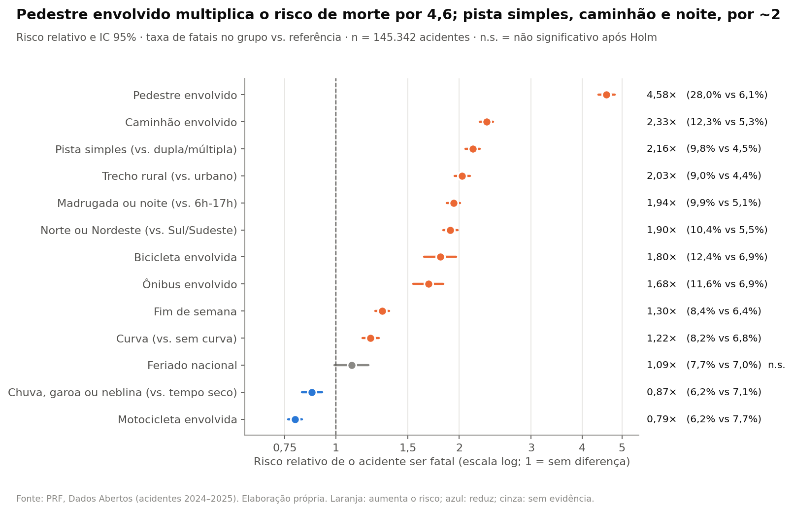
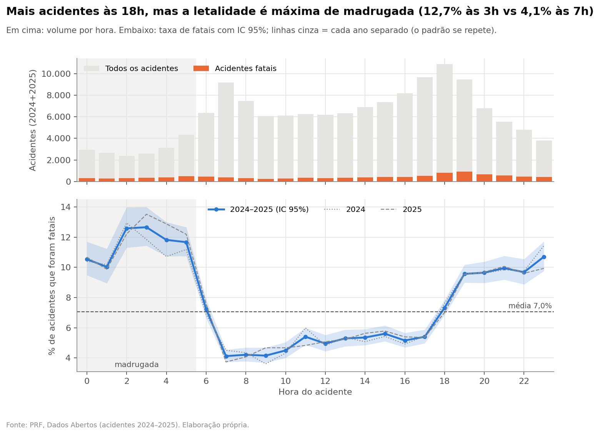
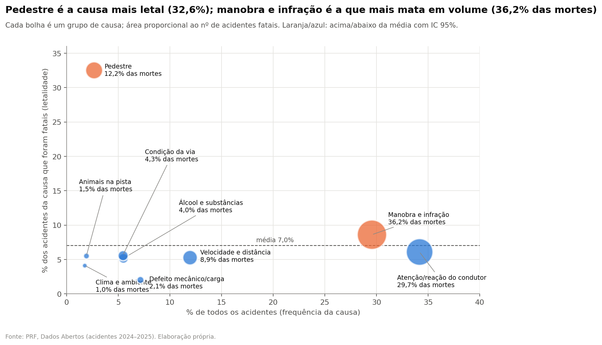
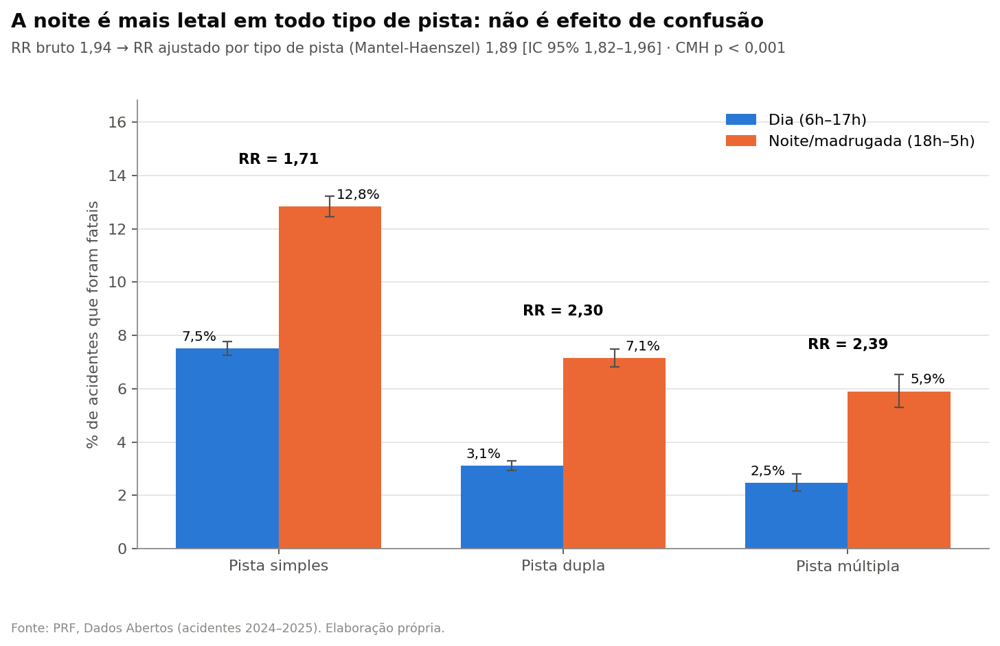
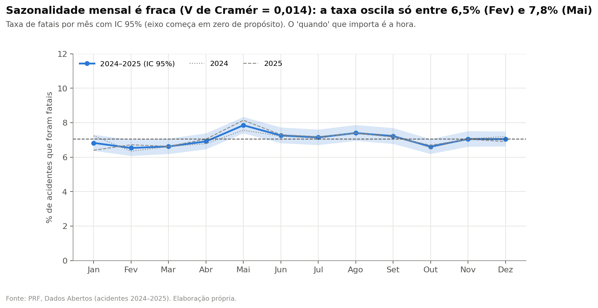
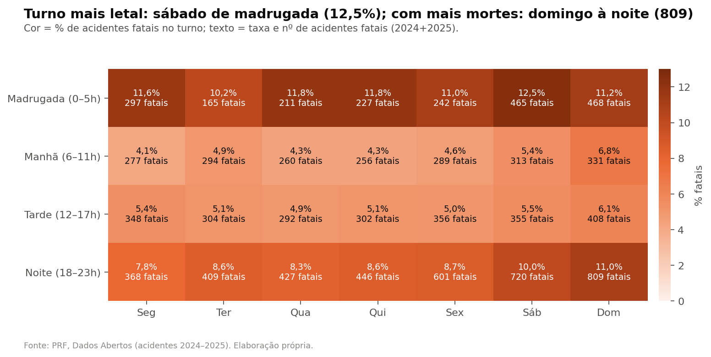
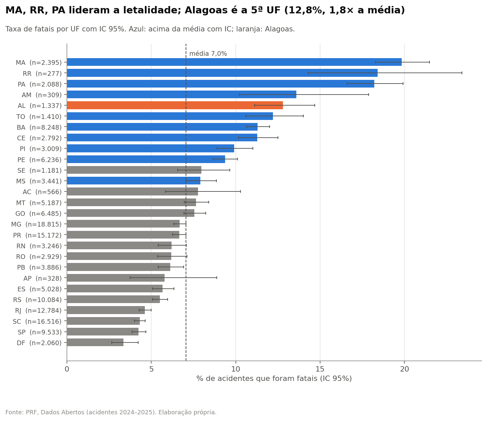
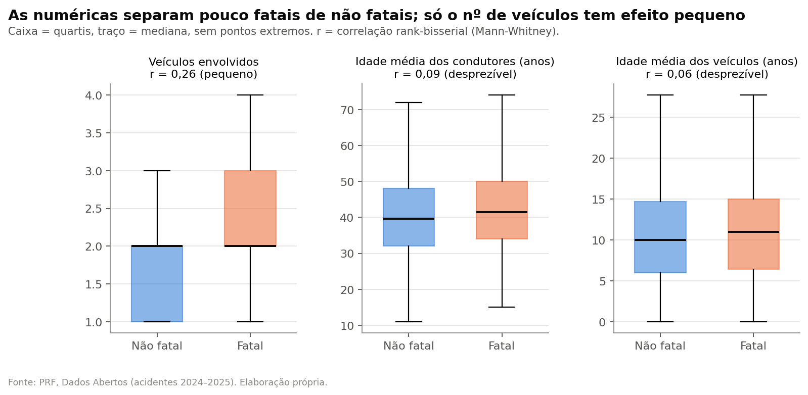

# README — Análise Exploratória (EDA) e Estatística (Pessoa 2)

> README **da parte de EDA e Estatística**. É **gerado por código** (`python -m src.p2_eda.executar_eda`) e todos os números vêm de [`tabelas/`](tabelas/). Não edite à mão: rode de novo.
> A seção do artigo está em [`secao_estatistica_descritiva_inferencia.md`](secao_estatistica_descritiva_inferencia.md) (revisão) e [`.tex`](secao_estatistica_descritiva_inferencia.tex) (para o template SBC).

## 1. Resumo em 30 segundos

- **Base:** 145.342 acidentes da PRF (2024–2025), 10.240 fatais: **7,05%** (IC 95% 6,92–7,18%). Taxa estável entre os anos (7,04% e 7,06%).
- **A "dor":** pedestre envolvido multiplica o risco de morte por **4,6**; caminhão, pista simples, trecho rural, noite e Norte/Nordeste, por **~2** cada.
- **O achado mais acionável:** colisão frontal em pista simples é 5,9% dos acidentes e **26,1% das mortes**.
- **Causa raiz x confusão:** noite, pista simples e região continuam com RR ≈ 1,7–2,0 mesmo comparando só acidentes do mesmo tipo de pista/trecho (Cochran-Mantel-Haenszel).
- **Hipóteses derrubadas (também é resultado):** moto, chuva e feriado **não** aumentam a letalidade por acidente; sazonalidade mensal é desprezível.
- **Rigor:** 30 testes corrigidos juntos por Holm; todo efeito replicado em 2024 **e** 2025; conclusões pelo tamanho do efeito, não só pelo p-valor.

## 2. Como rodar

```bash
python -m src.p2_eda.executar_eda   # ~10 s; lê data/processed/, escreve reports/
pytest tests/test_eda_p2.py         # testes das funções estatísticas e das saídas
```

Notebook para navegar pelos resultados: [`notebooks/p2_eda.ipynb`](../notebooks/p2_eda.ipynb).

## 3. Por que esses métodos (a pergunta que a banca faz)

| Escolha | Por quê | Alternativa descartada |
|---|---|---|
| **Risco relativo (RR)** como efeito principal | É a linguagem do gestor: "pista simples tem 2,2 vezes o risco". | Odds ratio: difícil de explicar e exagera quando o evento não é raro. |
| **IC de Wilson** para taxas | Correto para proporções pequenas (7%) e grupos pequenos (pedestre, UF). | IC "normal" (Wald): erra para p pequeno. |
| **Qui-quadrado + V de Cramér** | Teste diz *se* há associação, V diz *quanto*, e permite comparar variáveis. | Só p-valor: com 145 mil linhas, tudo é "significativo". |
| **Mann-Whitney** + r rank-bisserial | Numéricas são assimétricas (veículos: assimetria 5,4); não supõe normalidade. | Teste t: supõe normalidade. |
| **Cochran-Mantel-Haenszel** | Testa o fator *dentro* de estratos: separa causa raiz de confusão. | Comparar só taxas brutas. |
| **Holm** em todos os 30 testes | Controla falso positivo da família inteira; mais poderoso que Bonferroni. | Nenhuma correção. |
| **Réplica 2024 x 2025** | Padrão real não some de um ano para outro. | Analisar só o total. |

**Ponto fino que vale ouro na banca:** o V de Cramér/phi de "noite" é só 0,092 ("desprezível" pela régua de Cohen), mas o risco **dobra** (RR 1,94). Não é contradição: com desfecho raro (7%) o phi é limitado pelo próprio desbalanceamento. Por isso o V serve para **comparar** variáveis, e o RR para julgar a **importância prática**.

## 4. Vereditos das hipóteses

| Hip. | Enunciado | Veredito |
|---|---|---|
| H1 | Acidentes de madrugada e à noite são mais letais do que os de dia. | **confirmada** |
| H2 | Pista simples, trecho rural e curva elevam a letalidade. | **confirmada** |
| H3 | Pedestres, ciclistas, motociclistas e veículos pesados elevam a letalidade. | **parcial** |
| H4 | Norte e Nordeste têm letalidade maior do que Sul e Sudeste. | **confirmada** |
| H5 | Fins de semana e feriados são mais letais. | **parcial** |
| H6 | Tempo ruim (chuva, neblina) eleva a letalidade. | **rejeitada (efeito oposto)** |
| H7 | A causa e o tipo do acidente mudam muito a letalidade. | **confirmada** |
| H8 | Idade dos condutores, idade dos veículos e nº de veículos diferem entre fatais e não fatais. | **parcial** |
| H9 | Há sazonalidade mensal na letalidade. | **significativa, efeito desprezível** |

## 5. Fatores de risco (comparações 2x2)

| Hip. | Fator | Taxa grupo | Taxa ref. | RR (IC 95%) | RR 2024 / 2025 | % das mortes no grupo | p (Holm) | Replica? |
|---|---|---|---|---|---|---|---|---|
| H3 | Pedestre envolvido | 28,0% | 6,1% | 4,58 (4,38–4,79) | 4,68 / 4,49 | 16,9% | < 0,001 | sim |
| H3 | Caminhão envolvido | 12,3% | 5,3% | 2,33 (2,25–2,42) | 2,33 / 2,34 | 44,2% | < 0,001 | sim |
| H2 | Pista simples (vs. dupla/múltipla) | 9,8% | 4,5% | 2,16 (2,08–2,25) | 2,21 / 2,11 | 66,7% | < 0,001 | sim |
| H2 | Trecho rural (vs. urbano) | 9,0% | 4,4% | 2,03 (1,95–2,12) | 2,06 / 2,01 | 73,0% | < 0,001 | sim |
| H1 | Madrugada ou noite (vs. 6h-17h) | 9,9% | 5,1% | 1,94 (1,87–2,01) | 1,95 / 1,93 | 57,2% | < 0,001 | sim |
| H4 | Norte ou Nordeste (vs. Sul/Sudeste) | 10,4% | 5,5% | 1,90 (1,83–1,98) | 1,90 / 1,91 | 41,0% | < 0,001 | sim |
| H3 | Bicicleta envolvida | 12,4% | 6,9% | 1,80 (1,64–1,97) | 1,60 / 2,01 | 4,2% | < 0,001 | sim |
| H3 | Ônibus envolvido | 11,6% | 6,9% | 1,68 (1,55–1,83) | 1,60 / 1,77 | 4,9% | < 0,001 | sim |
| H5 | Fim de semana | 8,4% | 6,4% | 1,30 (1,25–1,35) | 1,28 / 1,32 | 37,8% | < 0,001 | sim |
| H2 | Curva (vs. sem curva) | 8,2% | 6,8% | 1,22 (1,16–1,27) | 1,18 / 1,26 | 21,5% | < 0,001 | sim |
| H5 | Feriado nacional | 7,7% | 7,0% | 1,09 (0,99–1,20) | 1,05 / 1,14 | 4,0% | 0,070 | não |
| H6 | Chuva, garoa ou neblina (vs. tempo seco) | 6,2% | 7,1% | 0,87 (0,83–0,93) | 0,86 / 0,90 | 12,3% | < 0,001 | sim |
| H3 | Motocicleta envolvida | 6,2% | 7,7% | 0,79 (0,76–0,83) | 0,81 / 0,78 | 38,4% | < 0,001 | sim |

## 6. Qui-quadrado de independência (variável x fatal)

| Hip. | Variável | Categorias | gl | χ² | V de Cramér | Magnitude | p (Holm) | Maior taxa |
|---|---|---|---|---|---|---|---|---|
| H1 | faixa_horaria | 4 | 3 | 1339 | 0,096 | desprezível | < 0,001 | Madrugada (11,5%) |
| H1 | dia_semana | 7 | 6 | 190 | 0,036 | desprezível | < 0,001 | domingo (8,7%) |
| H2 | tipo_pista | 3 | 2 | 1538 | 0,103 | pequeno | < 0,001 | Simples (9,8%) |
| H4 | regiao | 5 | 4 | 1045 | 0,085 | desprezível | < 0,001 | Norte (11,2%) |
| H4 | uf | 27 | 26 | 2130 | 0,121 | pequeno | < 0,001 | MA (19,8%) |
| H6 | condicao_metereologica | 8 | 7 | 143 | 0,031 | desprezível | < 0,001 | Nao_informado (10,7%) |
| H7 | grupo_causa | 9 | 8 | 4621 | 0,178 | pequeno | < 0,001 | Pedestre (32,6%) |
| H7 | tipo_acidente | 16 | 15 | 13530 | 0,305 | médio | < 0,001 | Colisão frontal (29,4%) |
| H9 | mes | 12 | 11 | 28 | 0,014 | desprezível | 0,006 | 5.0 (7,8%) |

Categorias com menos de 200 acidentes foram agregadas em "Outras" (e, se nem assim chegassem a 200, excluídas), para garantir frequência esperada ≥ 5 em todas as células.

## 7. Numéricas: fatais x não fatais (Mann-Whitney)

| Variável | Mediana fatal / não fatal | Média fatal / não fatal | r rank-bisserial | Magnitude | p (Holm) |
|---|---|---|---|---|---|
| veiculos | 2,0 / 2,0 | 2,50 / 1,95 | 0,260 | pequeno | < 0,001 |
| idade_media_condutores | 41,5 / 39,7 | 42,16 / 40,40 | 0,092 | desprezível | < 0,001 |
| idade_media_veiculos | 11,0 / 10,0 | 11,39 / 10,84 | 0,055 | desprezível | < 0,001 |
| pct_condutores_homens | 100,0 / 100,0 | 94,14 / 87,81 | 0,089 | desprezível | < 0,001 |

## 8. Causa raiz x confusão (estratificação)

| Análise | RR bruto | RR ajustado (MH) | % do efeito mantido | p (Holm) |
|---|---|---|---|---|
| Noite/madrugada, controlando o tipo de pista | 1,94 | 1,89 (1,82–1,96) | 96% | < 0,001 |
| Noite/madrugada, controlando trecho urbano/rural | 1,94 | 1,91 (1,84–1,98) | 98% | < 0,001 |
| Pista simples, controlando trecho urbano/rural | 2,16 | 1,96 (1,88–2,04) | 87% | < 0,001 |
| Norte/Nordeste, controlando o tipo de pista | 1,90 | 1,74 (1,67–1,81) | 86% | < 0,001 |

Detalhe por estrato: [`tabelas/p2_estratificadas_por_estrato.csv`](tabelas/p2_estratificadas_por_estrato.csv).

## 9. Figuras

As 4 **principais** vão para o artigo e para os slides; as 4 **de apoio** ficam aqui (e podem ir para um apêndice ou para o dashboard). O título de cada figura já é a conclusão.

#### 1. Fatores de risco (forest plot). **A figura da "dor".** *(Principal)*



#### 2. Hora do dia: volume x letalidade ("tesoura"). *(Principal)*



#### 3. Causas: o que é frequente x o que é letal. *(Principal)*



#### 4. Estratificação: a noite não é efeito da pista. *(Principal)*



#### 5. Sazonalidade mensal (resultado negativo, honesto). *(Apoio)*



#### 6. Mapa de calor dia x turno (operacional). *(Apoio)*



#### 7. Taxa por UF, com Alagoas destacada. *(Apoio)*



#### 8. Boxplots das numéricas (efeitos pequenos). *(Apoio)*



## 10. Para a Pessoa 3 (modelagem): ranking de associação com o alvo

V de Cramér de cada atributo com `acidente_fatal` (numéricas cortadas em 5 quantis, nulo como categoria). Não substitui a importância do modelo, mas orienta a seleção.

| # | Atributo | V de Cramér | Magnitude | Observação para a modelagem |
|---|---|---|---|---|
| 1 | `tipo_acidente` | 0,305 | médio | Pós-evento (definido pela PRF no atendimento): ótimo para explicar, não para alertar antes. |
| 2 | `grupo_causa` | 0,178 | pequeno | Pós-evento (definido pela PRF no atendimento): ótimo para explicar, não para alertar antes. |
| 3 | `envolve_pedestre` | 0,173 | pequeno |  |
| 4 | `veiculos` | 0,132 | pequeno |  |
| 5 | `uf` | 0,121 | pequeno | Alta cardinalidade (27): considerar target encoding dentro do CV ou usar 'regiao'. |
| 6 | `envolve_caminhao` | 0,119 | pequeno |  |
| 7 | `br` | 0,114 | pequeno | Alta cardinalidade: target encoding dentro do CV, ou deixar de fora. |
| 8 | `tipo_pista` | 0,103 | pequeno |  |
| 9 | `hora` | 0,102 | pequeno | Relação não linear (pico na madrugada): usar faixa_horaria ou codificação cíclica. |
| 10 | `fase_dia` | 0,098 | desprezível | Redundante com faixa_horaria/hora; escolher uma das três. |
| 11 | `faixa_horaria` | 0,096 | desprezível |  |
| 12 | `veiculos_outlier` | 0,090 | desprezível |  |
| 13 | `area_urbana` | 0,089 | desprezível |  |
| 14 | `latitude` | 0,085 | desprezível | Associação vem da geografia (Norte/Nordeste); redundante com uf/regiao. |
| 15 | `regiao` | 0,085 | desprezível |  |
| 16 | `pct_condutores_homens` | 0,064 | desprezível | Sensível: usar com cautela e auditar equidade. Imputar no Pipeline. |
| 17 | `idade_media_veiculos` | 0,054 | desprezível | Imputar no Pipeline (nulos). |
| 18 | `idade_media_condutores` | 0,045 | desprezível | Sensível: usar com cautela e auditar equidade. Imputar no Pipeline. |
| 19 | `via_intersecao` | 0,040 | desprezível |  |
| 20 | `via_rotatoria_retorno` | 0,040 | desprezível |  |
| 21 | `via_declive` | 0,037 | desprezível |  |
| 22 | `dia_semana` | 0,036 | desprezível |  |
| 23 | `longitude` | 0,036 | desprezível | Associação vem da geografia (Norte/Nordeste); redundante com uf/regiao. |
| 24 | `fim_de_semana` | 0,035 | desprezível |  |
| 25 | `envolve_bicicleta` | 0,033 | desprezível |  |
| 26 | `condicao_metereologica` | 0,031 | desprezível |  |
| 27 | `envolve_onibus` | 0,031 | desprezível |  |
| 28 | `envolve_moto` | 0,031 | desprezível |  |
| 29 | `km` | 0,027 | desprezível |  |
| 30 | `via_curva` | 0,022 | desprezível |  |
| 31 | `via_aclive` | 0,019 | desprezível |  |
| 32 | `sentido_via` | 0,016 | desprezível |  |
| 33 | `km_outlier` | 0,015 | desprezível |  |
| 34 | `mes` | 0,014 | desprezível |  |
| 35 | `via_reta` | 0,009 | desprezível |  |
| 36 | `via_obras_desvio` | 0,007 | desprezível |  |
| 37 | `eh_feriado` | 0,005 | desprezível |  |
| 38 | `idade_media_condutores_outlier` | 0,004 | desprezível |  |
| 39 | `via_ponte_viaduto_tunel` | 0,003 | desprezível |  |
| 40 | `idade_media_veiculos_outlier` | 0,003 | desprezível |  |
| 41 | `ano` | 0,000 | desprezível | Não usar como atributo: reservado para validação temporal (2024 treino, 2025 teste). |

Recomendações:
- **Desbalanceamento:** 7,05% de positivos → usar `class_weight`/limiar ajustado e avaliar com F1, AUC-ROC e **AUC-PR** (mais informativa com classe rara).
- **Dois cenários de modelo:** com `tipo_acidente`/`grupo_causa` (explicar o risco, definidos após o atendimento) e **sem** eles (prevenção: só condições conhecidas antes — hora, dia, via, região, tipo de veículo). Comparar os dois é uma ótima discussão.
- `hora` tem relação **não linear** (pico às 3h, vale às 7h): árvores lidam bem; para Regressão Logística, usar `faixa_horaria` ou seno/cosseno da hora.
- `ano` fica fora dos atributos (validação temporal: 2024 treino, 2025 teste). Os RRs quase idênticos entre os anos (seção 5) indicam que essa validação é justa.

## 11. Para a Pessoa 4 (insights) e a Pessoa 5 (artigo/dashboard)

- **Insights prontos para o formato do PDF** ("Percebemos que... Por isso recomendamos... sustentado por... medido por..."):
  1. *Quando:* 18h–5h concentram 57,2% das mortes com RR 1,94 [IC 95%: 1,87–2,01].
  2. *Onde:* pista simples, RR 2,16 [IC 95%: 2,08–2,25]; colisão frontal em pista simples = 26,1% das mortes → faixas de ultrapassagem, separador central, fiscalização de ultrapassagem indevida.
  3. *Quem:* pedestre, RR 4,58 [IC 95%: 4,38–4,79] → passarelas, iluminação e travessias em trechos urbanos de rodovia.
- O SHAP (Pessoa 4) deve **confirmar** estes sinais; se o modelo discordar, é ponto de discussão.
- Pessoa 5: `\input{reports/secao_estatistica_descritiva_inferencia.tex}` no template; figuras em `reports/figuras/`. A seção ocupa ~4 páginas com 3 figuras e 3 tabelas; se faltar espaço nas 12 páginas, cortar primeiro a Tabela 1 (descritiva) e reduzir as figuras para `0.75\linewidth`. `tabelas/p2_taxa_por_grupo.csv` está em formato longo, pronto para filtros de dashboard.

## 12. Limitações

- **Associação, não causa:** estudo observacional; o CMH controla só os estratos testados.
- **Variáveis pós-evento:** causa e tipo são atribuídos pela PRF depois do acidente (possível sub-registro de álcool em fatais).
- **Viés de registro:** só acidentes atendidos pela PRF em rodovias federais.
- **Taxa por acidente, não por exposição:** "moto tem letalidade menor por acidente" não significa que andar de moto é mais seguro; não temos km rodados por tipo de veículo.

## 13. Arquivos gerados

| Pasta | Conteúdo |
|---|---|
| `reports/figuras/` | 8 figuras `p2_fig*.png` (160 dpi) |
| `reports/tabelas/` | 16 tabelas `p2_*.csv` (uma por análise) |
| `reports/` | este README e a seção do artigo (`.md` e `.tex`) |
| `src/p2_eda/` | código: `configuracao`, `estatistica`, `analises`, `graficos`, `documentacao`, `executar_eda` |
| `tests/test_eda_p2.py` | testes |
