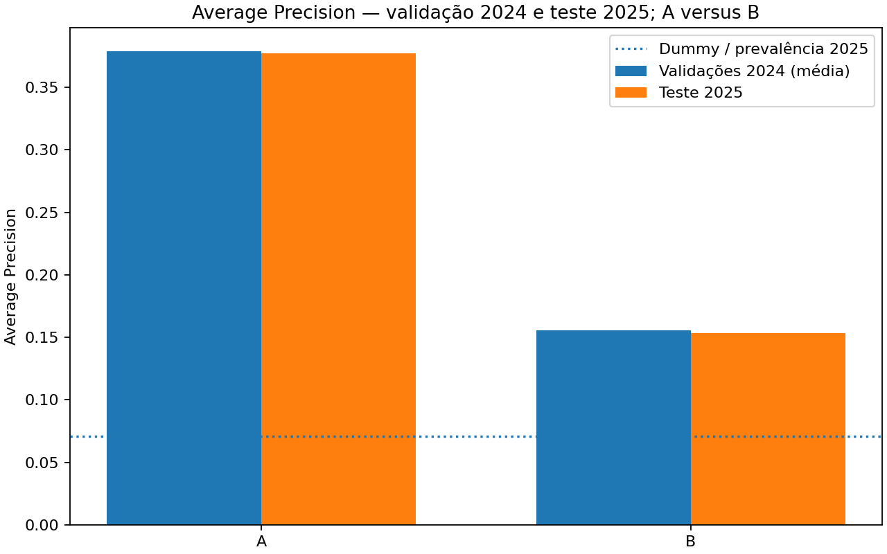
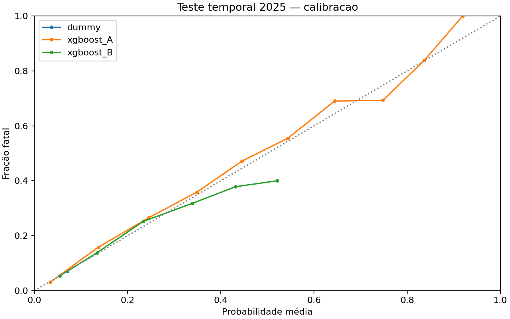
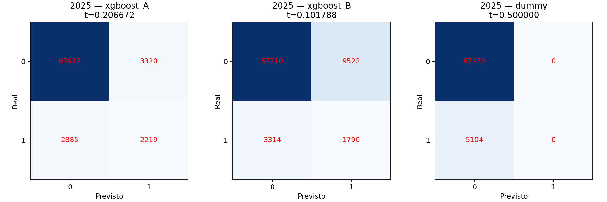
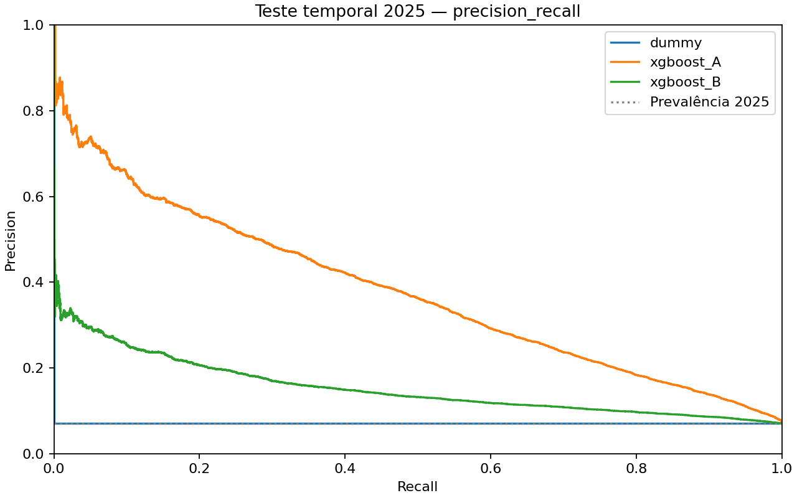
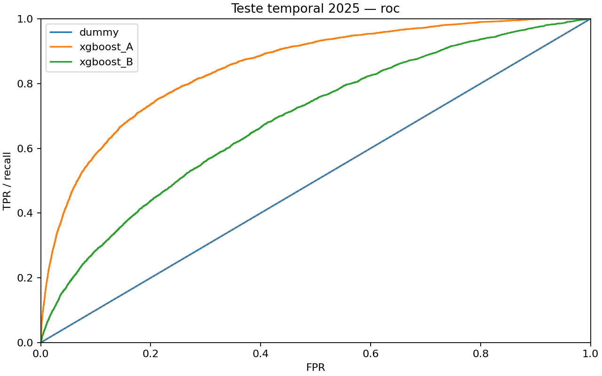

# Pessoa 3 — avaliação temporal final 2025


Treino: todos os registros de 2024. XGBoost padrão e limiares congelados antes da inferência final. Baseline prior treinado uma vez; probabilidade constante comum aos cenários.


## Métricas de 2025


| modelo | cenario | algoritmo | variante | ano | tipo_limiar | n_treino | tempo_treino_s | tempo_inferencia_s | n_validacao | n_positivos | limiar | ap | roc_auc | precision | recall | f1 | tp | fp | tn | fn | brier | log_loss | prevalencia | indefinidas |
| --- | --- | --- | --- | --- | --- | --- | --- | --- | --- | --- | --- | --- | --- | --- | --- | --- | --- | --- | --- | --- | --- | --- | --- | --- |
| xgboost_A | A | xgboost | padrao | 2025 | congelado_2024 | 73006 | 1.275806 | 0.532635 | 72336 | 5104 | 0.206672 | 0.377379 | 0.850367 | 0.400614 | 0.434757 | 0.416988 | 2219 | 3320 | 63912 | 2885 | 0.053186 | 0.192457 | 0.070560 | indefinida |
| xgboost_A | A | xgboost | padrao | 2025 | descritivo_0.5 | 73006 | 1.275806 | 0.532635 | 72336 | 5104 | 0.500000 | 0.377379 | 0.850367 | 0.620690 | 0.116379 | 0.196007 | 594 | 363 | 66869 | 4510 | 0.053186 | 0.192457 | 0.070560 | indefinida |
| xgboost_B | B | xgboost | padrao | 2025 | congelado_2024 | 73006 | 0.652414 | 0.254281 | 72336 | 5104 | 0.101788 | 0.153435 | 0.685863 | 0.158239 | 0.350705 | 0.218080 | 1790 | 9522 | 57710 | 3314 | 0.063204 | 0.239816 | 0.070560 | indefinida |
| xgboost_B | B | xgboost | padrao | 2025 | descritivo_0.5 | 73006 | 0.652414 | 0.254281 | 72336 | 5104 | 0.500000 | 0.153435 | 0.685863 | 0.400000 | 0.000392 | 0.000783 | 2 | 3 | 67229 | 5102 | 0.063204 | 0.239816 | 0.070560 | indefinida |
| dummy | B | dummy | padrao | 2025 | baseline_0.5 | 73006 | 0.289433 | 0.207597 | 72336 | 5104 | 0.500000 | 0.070560 | 0.500000 | indefinida | 0.000000 | 0.000000 | 0 | 0 | 67232 | 5104 | 0.065581 | 0.255084 | 0.070560 | precision: nenhum positivo previsto |


Precision indefinida sem positivos previstos é registrada como campo vazio no CSV/null no JSON.


## Comparação 2024/2025


| cenario | limiar | ap_dummy_2025 | prevalencia_2025 | ap_sobre_dummy | ap_menos_prevalencia_2025 | ap_media_validacao_2024_05 | ap_teste_2025 | ap_delta_2025_menos_media_2024 | roc_auc_media_validacao_2024_05 | roc_auc_teste_2025 | roc_auc_delta_2025_menos_media_2024 | brier_media_validacao_2024_05 | brier_teste_2025 | brier_delta_2025_menos_media_2024 | log_loss_media_validacao_2024_05 | log_loss_teste_2025 | log_loss_delta_2025_menos_media_2024 | precision_media_validacao_2024_05 | precision_teste_2025 | precision_delta_2025_menos_media_2024 | recall_media_validacao_2024_05 | recall_teste_2025 | recall_delta_2025_menos_media_2024 | f1_media_validacao_2024_05 | f1_teste_2025 | f1_delta_2025_menos_media_2024 | precision_ajuste_reunido_2024_otimista | recall_ajuste_reunido_2024_otimista | f1_ajuste_reunido_2024_otimista |
| --- | --- | --- | --- | --- | --- | --- | --- | --- | --- | --- | --- | --- | --- | --- | --- | --- | --- | --- | --- | --- | --- | --- | --- | --- | --- | --- | --- | --- | --- |
| A | 0.206672 | 0.070560 | 0.070560 | 5.348377 | 0.306820 | 0.378798 | 0.377379 | -0.001418 | 0.850139 | 0.850367 | 0.000228 | 0.053357 | 0.053186 | -0.000171 | 0.192962 | 0.192457 | -0.000505 | 0.611457 | 0.400614 | -0.210843 | 0.121741 | 0.434757 | 0.313016 | 0.203025 | 0.416988 | 0.213963 | 0.404091 | 0.448957 | 0.425344 |
| B | 0.101788 | 0.070560 | 0.070560 | 2.174539 | 0.082875 | 0.155628 | 0.153435 | -0.002194 | 0.688005 | 0.685863 | -0.002141 | 0.063489 | 0.063204 | -0.000285 | 0.240476 | 0.239816 | -0.000661 | 0.000000 | 0.158239 | 0.158239 | 0.000000 | 0.350705 | 0.350705 | 0.000000 | 0.218080 | 0.218080 | 0.161270 | 0.372951 | 0.225172 |


As médias de 2024 usam limiar 0,5 para precision/recall/F1. As colunas ajuste_reunido_2024_otimista usam os limiares candidatos nas próprias previsões que os escolheram; não são avaliação independente. Deltas são diferenças assinadas em unidades da métrica, sem normalização percentual.


Cenário A: ΔAP=-0.001418; a diferença não prova uma causa nem compara condições idênticas.

Cenário B: ΔAP=-0.002194; a diferença não prova uma causa nem compara condições idênticas.


## Calibração aproximada


| modelo | ano | faixa | n | probabilidade_media | fracao_fatal |
| --- | --- | --- | --- | --- | --- |
| dummy | 2025 | (-0.001, 0.1] | 72336 | 0.070350 | 0.070560 |
| xgboost_A | 2025 | (-0.001, 0.1] | 60207 | 0.033522 | 0.030445 |
| xgboost_A | 2025 | (0.1, 0.2] | 6411 | 0.136803 | 0.158010 |
| xgboost_A | 2025 | (0.2, 0.3] | 1993 | 0.245162 | 0.265429 |
| xgboost_A | 2025 | (0.3, 0.4] | 1508 | 0.348726 | 0.358753 |
| xgboost_A | 2025 | (0.4, 0.5] | 1260 | 0.445165 | 0.471429 |
| xgboost_A | 2025 | (0.5, 0.6] | 573 | 0.543895 | 0.554974 |
| xgboost_A | 2025 | (0.6, 0.7] | 213 | 0.644282 | 0.690141 |
| xgboost_A | 2025 | (0.7, 0.8] | 101 | 0.747964 | 0.693069 |
| xgboost_A | 2025 | (0.8, 0.9] | 68 | 0.836793 | 0.838235 |
| xgboost_A | 2025 | (0.9, 1.0] | 2 | 0.919340 | 1.000000 |
| xgboost_B | 2025 | (-0.001, 0.1] | 60508 | 0.054249 | 0.053811 |
| xgboost_B | 2025 | (0.1, 0.2] | 10188 | 0.134321 | 0.138398 |
| xgboost_B | 2025 | (0.2, 0.3] | 1312 | 0.233726 | 0.252287 |
| xgboost_B | 2025 | (0.3, 0.4] | 286 | 0.339452 | 0.318182 |
| xgboost_B | 2025 | (0.4, 0.5] | 37 | 0.431427 | 0.378378 |
| xgboost_B | 2025 | (0.5, 0.6] | 5 | 0.521367 | 0.400000 |


Faixas fixas de 0,1, sem reajuste. Compare probabilidade média e fração fatal considerando n; faixas pequenas são instáveis. Brier e Log Loss menores representam melhor qualidade probabilística, mas não provam calibração perfeita.


## Gráficos













## Consumo pelas Pessoas 4 e 5


Carregue apenas os joblib confiáveis produzidos aqui, em ambiente Python compatível. As versões, features originais/transformadas, parâmetros completos, caminhos e hashes estão em [manifesto.json](manifesto.json).


```python
from src.p3_modelagem.executar_avaliacao_final import carregar_pipeline, prever, LIMIARES
from src.p3_modelagem.dados import carregar_base, selecionar_xy
modelo = carregar_pipeline('A')
base = carregar_base()
X, y = selecionar_xy(base, 'A')
X_transformado = modelo.named_steps['preprocessamento'].transform(X)
nomes = modelo.named_steps['preprocessamento'].get_feature_names_out()
estimador = modelo.named_steps['modelo']
# SHAP deve alinhar X_transformado e nomes.
# Para a avaliação de 2025, reutilize as previsões salvas, sem nova inferência.
```


`prever(modelo, base, cenario)` preserva índice e aplica o limiar congelado; `pipeline.predict` usa a decisão padrão do estimador e não substitui essa interface. Nas tabelas de previsões, linha_original é o índice posicional original do CSV (base zero); modelo + linha_original é chave única. Não há SHAP ou dashboard implementado.


[Métricas](metricas_2025.csv), [previsões](previsoes_2025.csv.gz), [comparação](comparacao_2024_2025.csv), [calibração](calibracao_2025.csv).


## Limitações metodológicas


O teste de 2025 foi reservado à avaliação final da Pessoa 3, mas já foi utilizado
em auditorias e análises exploratórias anteriores: não é completamente cego.
A engenharia anterior usou a base conjunta 2024/2025; indicadores globais de outliers
foram excluídos dos preditores, mas a dependência do processamento anterior permanece.
As métricas descrevem acidentes registrados pela PRF, sem exposição ao tráfego ou
observações sem acidente. A utiliza informações observadas após o acidente; B usa
localização/calendário antecipadamente especificáveis. Ambos estimam fatalidade
condicional à ocorrência de um acidente registrado, nunca probabilidade de acidente.
B sozinho não permite inferir risco absoluto por trecho nem demanda de fiscalização.
A seleção de limiares nas próprias validações de 2024 pode apresentar otimismo;
2025 avalia esses limiares independentemente. Não houve generalização espacial
independente nem análise causal. As validações usaram treinos de tamanhos diferentes;
o treino definitivo usa todo 2024. Mudanças observadas não identificam suas causas.
AP é Average Precision sobre probabilidades, distinta de acurácia e de precision
em um limiar. Nenhuma escolha ou recalibração foi feita com resultados de 2025.


## Rastreabilidade e reprodução


Dataset: `data/processed/acidentes_prf_modelagem.csv`; SHA-256: `518f7d54e8f0093befd41939b47117344ee2983ab977d47124794c3212f05552`. HEAD: `80a677ce1abddd3e03e30208b2f7c1e22d62e2d6`. Fontes e artefatos têm hashes no manifesto. O estado local é registrado: o HEAD sozinho não inclui alterações não commitadas.


`python -m src.p3_modelagem.executar_avaliacao_final --somente-relatorios` reconstrói tabelas derivadas e figuras sem fit nem predict. A execução recusa saída preexistente e mantém checkpoint/estado em caso de falha técnica; não retome treinamentos para melhorar métricas.

