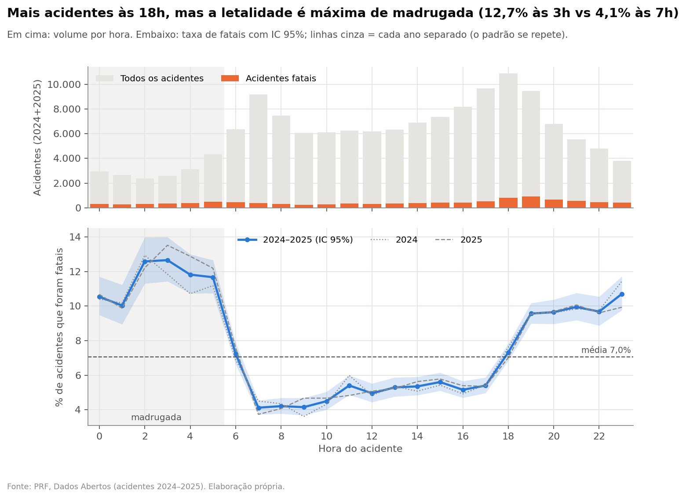
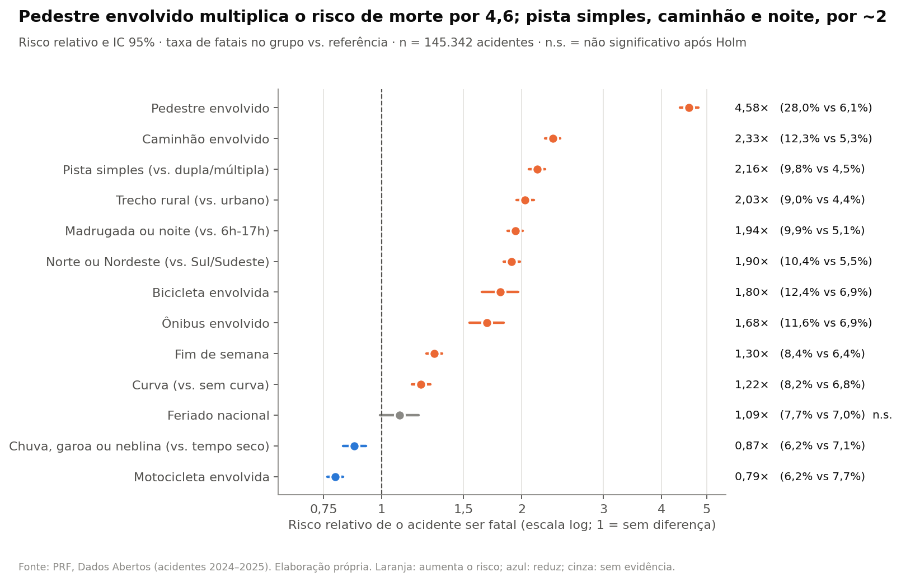
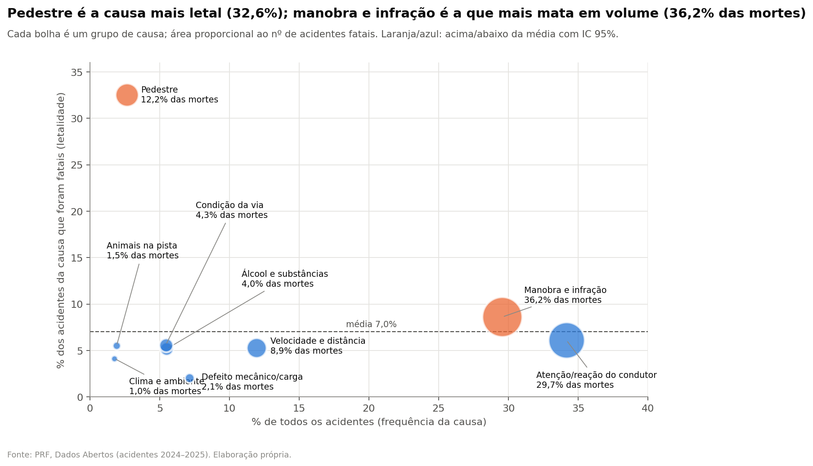

# Estatística Descritiva e Inferência

### Visão geral e estatística descritiva

A base tratada contém 145.342 acidentes, dos quais 10.240 tiveram ao menos uma morte: taxa de letalidade de **7,05%** (IC 95% de Wilson: 6,92%–7,18%). A taxa é praticamente idêntica em 2024 (7,04%) e 2025 (7,06%), o que permite tratar os dois anos em conjunto e, ao mesmo tempo, usá-los como **réplica** um do outro: um padrão só foi considerado robusto quando apareceu, no mesmo sentido e com intervalo de confiança excluindo a ausência de efeito, em cada ano separadamente. A Tabela 1 resume as variáveis numéricas. Todas são assimétricas (o número de veículos tem assimetria 5,4 e chega a 82) e o teste de D'Agostino-Pearson rejeita a normalidade em todas, o que justifica o uso de mediana e IQR na descrição e de testes não paramétricos na inferência. Os nulos (até 4,8%) foram mantidos como ausentes, sem imputação, conforme a seção anterior.

**Tabela 1.** Estatística descritiva das variáveis numéricas (n = 145.342).

| Variável | Média | Mediana | DP | IQR | Assim. | Nulos | Med. fatal / não fatal |
|---|---|---|---|---|---|---|---|
| Quilômetro da rodovia | 258,6 | 191,0 | 227,5 | 331,6 | 1,01 | 0,0% | 215,2 / 189,0 |
| Veículos envolvidos | 2,0 | 2,0 | 1,1 | 1,0 | 5,36 | 0,0% | 2,0 / 2,0 |
| Idade média dos condutores (anos) | 40,5 | 40,0 | 11,5 | 16,0 | 0,43 | 4,8% | 41,5 / 39,7 |
| % de condutores homens | 88,3 | 100,0 | 27,5 | 0,0 | -2,29 | 3,5% | 100,0 / 100,0 |
| Idade média dos veículos (anos) | 10,9 | 10,0 | 7,0 | 9,0 | 1,10 | 3,8% | 11,0 / 10,0 |

### Estratégia de inferência

Nove hipóteses (H1–H9, Tabela 3) foram testadas. Para comparações entre dois grupos usou-se o **risco relativo** (RR, com IC 95% pelo método log) e o teste qui-quadrado; para variáveis com várias categorias, o qui-quadrado de independência com **V de Cramér**; para as numéricas, o teste de **Mann-Whitney** com a correlação rank-bisserial como tamanho de efeito. Como o desfecho é raro (7%), o V de Cramér e o phi ficam numericamente pequenos mesmo quando o risco dobra; por isso a relevância prática é julgada pelo RR e pela diferença em pontos percentuais, e o V é usado para comparar variáveis entre si. Para separar causas de **confusão**, os principais fatores foram reavaliados dentro de estratos (teste de Cochran-Mantel-Haenszel, com RR ajustado de Mantel-Haenszel). Todos os 30 testes formam uma única família corrigida por **Holm** (α = 0,05). Com n = 145.342, quase toda diferença é estatisticamente significativa; as conclusões, portanto, apoiam-se no tamanho do efeito e na replicação entre anos, e não apenas no p-valor.

### Quando: hora, dia e mês

A hora é o fator temporal dominante (Figura 1). O volume de acidentes é máximo às 18h, mas a letalidade atinge 12,7% às 3h, contra 4,1% às 7h. Acidentes entre 18h e 5h são 9,9% fatais contra 5,1% durante o dia: RR = 1,94 [IC 95%: 1,87–2,01], e concentram 57,2% de todas as mortes (H1 confirmada). Os fins de semana elevam o risco (RR = 1,30 [IC 95%: 1,25–1,35]); o turno com mais acidentes fatais é domingo à noite (809). Feriados nacionais não diferem significativamente após a correção (RR = 1,09, p ajustado = 0,070), e a sazonalidade mensal, embora detectável, é desprezível (V = 0,014; taxas entre 6,5% e 7,8%), de modo que H5 é apenas parcialmente confirmada e H9 é rejeitada para fins de decisão.

**Figura 1.** Volume de acidentes (em cima) e taxa de letalidade com IC 95% (embaixo) por hora; linhas cinza mostram cada ano separadamente.

### Onde: tipo de via e região

Acidentes em pista simples são 9,8% fatais, contra 4,5% em pista dupla ou múltipla (RR = 2,16 [IC 95%: 2,08–2,25]); trechos rurais (RR = 2,03 [IC 95%: 1,95–2,12]) e curvas (RR = 1,22 [IC 95%: 1,16–1,27]) também elevam o risco (H2 confirmada). O mecanismo aparece ao cruzar pista e tipo de acidente: a **colisão frontal em pista simples** responde por apenas 5,9% dos acidentes, mas por **26,1% de todas as mortes** (letalidade de 31,4%), o que é coerente com a ausência de separação física entre sentidos. Norte e Nordeste têm letalidade 1,9 vez a de Sul e Sudeste (H4 confirmada); Alagoas é a 5ª UF mais letal (12,8%).

Esses fatores são correlacionados entre si (à noite e no Nordeste há mais pista simples, por exemplo). A análise estratificada (Tabela 2) mostra que nenhum deles é explicado pelo outro: o RR da noite passa de 1,94 para 1,89 quando se controla o tipo de pista e para 1,91 quando se controla o trecho urbano/rural; o da pista simples passa de 2,16 para 1,96; e o regional, de 1,90 para 1,74. Ao menos 86% de cada efeito (em escala log) sobrevive ao ajuste, indicando fatores com contribuição própria.

**Tabela 2.** Risco relativo bruto e ajustado por estrato (Mantel-Haenszel) e teste CMH.

| Análise | RR bruto | RR ajustado (IC 95%) | χ² CMH | p (Holm) |
|---|---|---|---|---|
| Noite/madrugada, controlando o tipo de pista | 1,94 | 1,89 (1,82–1,96) | 1143 | < 0,001 |
| Noite/madrugada, controlando trecho urbano/rural | 1,94 | 1,91 (1,84–1,98) | 1177 | < 0,001 |
| Pista simples, controlando trecho urbano/rural | 2,16 | 1,96 (1,88–2,04) | 1040 | < 0,001 |
| Norte/Nordeste, controlando o tipo de pista | 1,90 | 1,74 (1,67–1,81) | 731 | < 0,001 |

### Quem e por quê: envolvidos, clima e causa

O maior risco relativo é o de acidentes com **pedestre** (28,0% fatais; RR = 4,58 [IC 95%: 4,38–4,79]). Caminhões (RR = 2,33 [IC 95%: 2,25–2,42]) estão presentes em 44,2% dos acidentes fatais, e bicicletas e ônibus também elevam o risco (Figura 2). Já a **motocicleta**, contrariando a hipótese inicial, aparece com letalidade menor por acidente (6,2% vs. 7,7%; RR = 0,79 [IC 95%: 0,76–0,83]), provavelmente porque muitos registros com moto são quedas e colisões leves; por isso H3 é apenas parcial. Da mesma forma, chuva, garoa ou neblina **não** aumentam a letalidade (6,2% vs. 7,1%; RR = 0,87 [IC 95%: 0,83–0,93]), e H6 é rejeitada; uma explicação plausível, não testável com esta base, é a redução de velocidade em tempo ruim.

**Figura 2.** Risco relativo de o acidente ser fatal (IC 95%, escala log) para cada fator; cinza indica não significativo após Holm.

A causa e o tipo do acidente são as variáveis mais associadas ao desfecho (V = 0,18 e 0,31; H7 confirmada), mas a leitura correta exige separar **gravidade** de **volume** (Figura 3). A causa "pedestre" é a mais letal (32,6%), mas soma 12,2% das mortes; manobras e infrações combinam letalidade acima da média (8,6%) com o maior volume (36,2% das mortes), e falhas de atenção, mesmo abaixo da média, somam 29,7%. Álcool (5,2%) e velocidade (5,3%) ficam abaixo da média, resultado que deve ser lido com cautela: a causa é atribuída pela PRF após o atendimento e pode haver sub-registro nos casos fatais.

**Figura 3.** Frequência (eixo x) versus letalidade (eixo y) de cada grupo de causa; a área da bolha é proporcional ao número de acidentes fatais.

Entre as numéricas (H8), apenas o número de veículos tem efeito pequeno (r = 0,26; média de 2,50 veículos nos fatais vs. 1,95); a idade dos condutores (medianas de 41,5 vs. 39,7 anos) e a dos veículos diferem de forma significativa, porém desprezível. O risco, portanto, está mais no **contexto** (via, hora, região, quem está envolvido) do que no perfil numérico do acidente.

### Síntese

**Tabela 3.** Hipóteses testadas e veredito (Holm, α = 0,05, efeito replicado em 2024 e 2025).

| ID | Hipótese | Veredito |
|---|---|---|
| H1 | Acidentes de madrugada e à noite são mais letais do que os de dia. | confirmada |
| H2 | Pista simples, trecho rural e curva elevam a letalidade. | confirmada |
| H3 | Pedestres, ciclistas, motociclistas e veículos pesados elevam a letalidade. | parcial |
| H4 | Norte e Nordeste têm letalidade maior do que Sul e Sudeste. | confirmada |
| H5 | Fins de semana e feriados são mais letais. | parcial |
| H6 | Tempo ruim (chuva, neblina) eleva a letalidade. | rejeitada (efeito oposto) |
| H7 | A causa e o tipo do acidente mudam muito a letalidade. | confirmada |
| H8 | Idade dos condutores, idade dos veículos e nº de veículos diferem entre fatais e não fatais. | parcial |
| H9 | Há sazonalidade mensal na letalidade. | significativa, efeito desprezível |

A análise sustenta três frentes de decisão, detalhadas na seção de Resultados: (i) **quando**: reforço de fiscalização e iluminação entre 18h e 5h, sobretudo aos fins de semana; (ii) **onde**: trechos de pista simples, rurais, em curva e no Norte/Nordeste, com foco em evitar colisões frontais; (iii) **quem**: travessia de pedestres e convivência com veículos pesados. Para a modelagem, os atributos mais associados ao alvo são `tipo_acidente`, `grupo_causa`, `envolve_pedestre`, `veiculos`, `uf`; a associação de cada variável isolada é no máximo moderada, o que antecipa um desempenho preditivo moderado e reforça a necessidade de métricas adequadas a classes desbalanceadas. Como em todo estudo observacional, os resultados indicam associação, não causalidade.
